This blog had 113 posts when we did this work. Until then the related-articles list under each post came from rules: shared topics, links between posts and series order. We rebuilt it as a small knowledge graph. Articles and concepts are the nodes, a language model extracts which concepts each article explains or uses, three rankers propose up to 15 candidates per article, and one more model call per article picks at most four of them and, for each, writes one sentence saying why and points at one passage in each article. The result is stored as one JSON record per article in the repository, and the site build checks every record against the current text without calling a model.

We then had every recommendation judged. LLM agents that read both articles rated 158 of the model's 243 recommendations (65.0%) as a specific reason to read the other article next and 12 (4.9%) as unrelated. For the rule-based lists the same judges rated 147 of 369 (39.8%) as specific and 72 (19.5%) as unrelated. Ten of the 243 reason sentences stated something false about one of the articles, and all ten had passed every automatic check. This post describes the system, the audit and the manual corrections that the published lists contain. Section 8 covers how the graph and the outline beside the article are drawn.

## TL;DR {#tldr}

- Before any audit-driven correction, 158 of the model's 243 recommendations were judged specific and 12 unrelated; of the 369 rule-based recommendations, 147 were judged specific and 72 unrelated. Article by article, the judges preferred the model's list on 64 of 113 articles and the rule-based list on 26.
- Every pick has to name a candidate, an allowed relation type and one existing passage on each side. Of the 243 picks, 10 (4.1%) met all of this and carried a reason sentence that was false. On the first full pass the model also wrote four reasons in Japanese although the instruction asked for Korean.
- The published lists hold 233 model picks, none of them judged unrelated (an estimate, Section 7.4), and 26 links added by rule, 5 of which were judged unrelated. Getting there took 22 excluded pairs and 4 hand-written sentences, and 5 of the 8 picks the model produced to replace excluded ones were rejected as well. A new post gets no audit, and the rates above come from one judged pass.
- Of the 202 distinct pairs judged specific in either system's lists, the graph ranker (shared concepts, links between posts, series order) had 185 in its first 15 candidates, the lexical ranker 171 and the embedding ranker 193. Picks that all three rankers proposed were judged specific in 116 of 142 cases and never unrelated; picks from one ranker only were specific in 5 of 34 and unrelated in 9.
- Publishing one post costs 2 + k LLM calls, where k is the number of existing posts whose candidates or evidence changed. In four short test posts k was 6, 0, 2 and 11, and the logged LLM tokens come to between $0.001 and $0.011 per post at list prices. Building the site and viewing a page call no model.

Three conditions apply throughout. The judges were LLM agents, not a human reader, and they knew which system had produced each list. The corpus is one blog of 113 posts, 110 in Korean and 3 in English. All counts describe those 113 posts. This post is the 114th. Its own list, and the lists of the existing posts that were reranked when it was published (Section 6.2), came out of the same pipeline and are not part of any count below.

## 1. What a reader sees {#reader-view}

[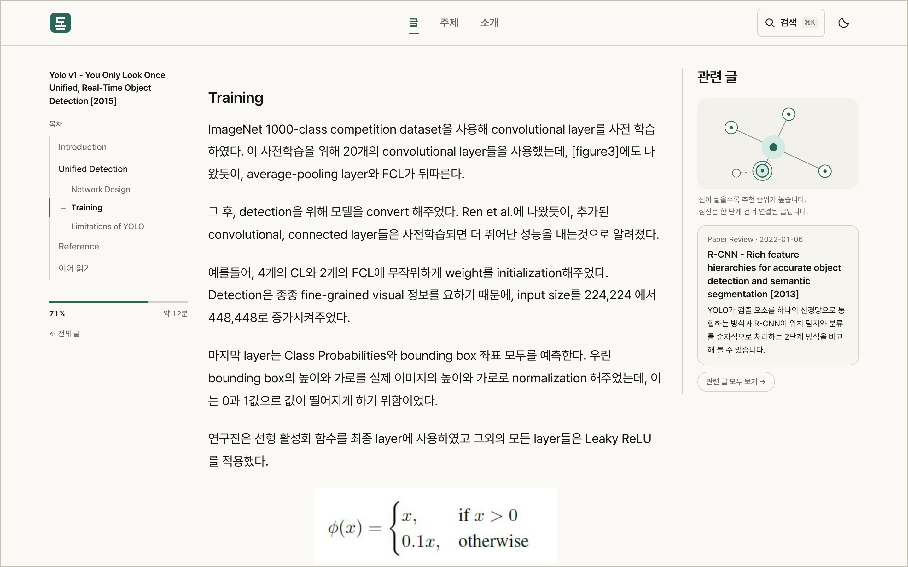](../assets/research/related-articles-graph/figures/shot_article_page.png)

*Figure 1. An article page at desktop width (the paper review [Yolo v1 - You Only Look Once Unified, Real-Time Object Detection [2015]](/paperreview/2022/01/04/YOLOv1.html)). Left: the outline with the current section's branch open and the reading-progress meter at 71%. Right: the related-articles graph and the card for the selected article.*

On a wide screen an article page has three columns (Figure 1). The panel on the right draws the current article as the filled node in the middle and up to four recommended articles around it. The nodes carry no labels: a card under the graph shows the selected article's type, date, title and reason sentence, and hovering, focusing or tapping a node selects it.

The length of an edge encodes rank, so the article on the shortest edge is the first recommendation. One more article, taken from the list of one of the recommended articles, hangs off that article on a dashed edge, and its card names the article it is reached through (Figure 2).

[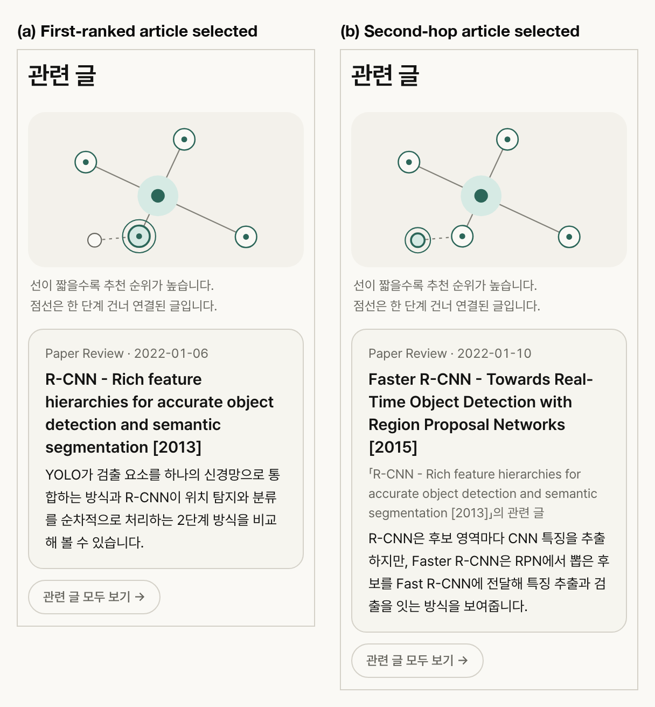](../assets/research/related-articles-graph/figures/shot_graph_panels.png)

*Figure 2. The panel from Figure 1. (a) The node on the shortest edge is selected (double ring). (b) The node on the dashed edge is selected, and the gray line in the card says it is a related article of the R-CNN review. The legend reads "the shorter the line, the higher the rank" and "a dashed line is an article one step further away".*

The reason sentences are Korean because most of the blog is. The one in panel (a) reads 「YOLO가 검출 요소를 하나의 신경망으로 통합하는 방식과 R-CNN이 위치 탐지와 분류를 순차적으로 처리하는 2단계 방식을 비교해 볼 수 있습니다.」 ("You can compare how YOLO merges the detection components into one network with R-CNN's two-stage approach, which handles localization and classification in sequence.")

## 2. The ontology {#ontology}

The knowledge graph behind the lists has two kinds of node: the 113 articles and 51 concepts such as Reranking, Object Detection or Korean OCR. It has three kinds of link. An article is `about` a concept when the concept is a main subject it explains or evaluates, and it `applies` a concept when it uses the technique. A concept can have a `broader` concept as its parent, in the sense of the SKOS vocabulary (Miles and Bechhofer, 2009).

The metadata kept with the posts holds 211 article-to-concept links (125 `about`, 86 `applies`), and the pipeline treats them as already checked by hand. Fact extraction (Section 3) added 23 that the metadata did not have, so ranking uses 234. The 17 `broader` links are used only for the site's topic pages and topic filters, not for ranking.

<a href="../assets/research/related-articles-graph/figures/fig_ontology.png">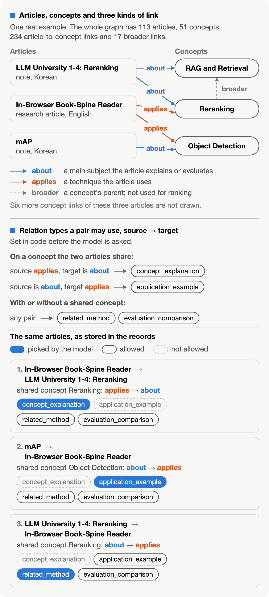</a>

*Figure 3. Top: three articles of this blog and three concepts, with five of their eleven concept links drawn. Bottom: the rule that decides which relation types a pair may use, and three stored pairs with the type the model picked.*

An article's link to a concept is its role on that concept, `about` or `applies`. The roles decide, in code, which relation types a recommendation may carry. A recommendation from a source article to a target article has one of four types. `concept_explanation` is allowed only if the source `applies` a concept that the target is `about`, and `application_example` only for the reverse. `related_method` and `evaluation_comparison` are always allowed. The first and third cards in Figure 3 show the same two articles in opposite directions. From the article that uses reranking to the note that explains it, `concept_explanation` is allowed, and the model picked it. In the other direction only `application_example` is allowed besides the two unrestricted types, and the model picked `related_method`.

## 3. Models and pipeline {#models}

We use two models, both through OpenRouter and both only when a post is published, never when the site is built or a page is viewed (Tables 1 and 2). Figure 4 shows where each one sits in the pipeline. It reads from top to bottom, and the dashed line separates publish time from the site build.

| Item | Value |
|---|---|
| Model | `openai/gpt-6-luna` |
| Used for | facts, reranking |
| Output | strict JSON schema |
| Seed | 7 |
| Reasoning effort | low |
| Output cap | 8,000 tokens |
| Temperature | not set (the model rejects it) |
| Parallel calls | 4 |
| Input price | $0.10 per 1M tokens |
| Output price | $0.50 per 1M tokens |
| Calls per pass | 110 + 110 |
| Runs | at publish time |
| Stored in | JSON records in Git |

*Table 1. The model for fact extraction and reranking. Prices are the list prices on its OpenRouter page when we ran it (OpenRouter, GPT-6 Luna). A pass is one extraction call and one reranking call for each of the 110 posts that have text.*

| Item | Value |
|---|---|
| Model | `google/gemini-embedding-2` |
| Used for | block vectors |
| Dimensions | first 768, renormalized |
| Batch size | up to 64 inputs |
| Price | $0.20 per 1M tokens |
| Vectors | 3,811 |
| Requests | 60 |
| Runs | at publish time |
| Stored in | Postgres + pgvector |

*Table 2. The embedding model (OpenRouter, Gemini Embedding 2). Only blocks that are not yet in the cache are sent. The cache is a Postgres table with the pgvector extension, hosted on Supabase (Supabase).*

The call counts in both tables are what one clean pass needs by design. We did not save the counts from the runs themselves (Section 9). The published records took more than one pass: a second reranking pass over all 110 posts and 16 further reranking calls after two rounds of exclusions (Section 7), which makes at least 346 LLM calls.

<a href="../assets/research/related-articles-graph/figures/fig_architecture.png">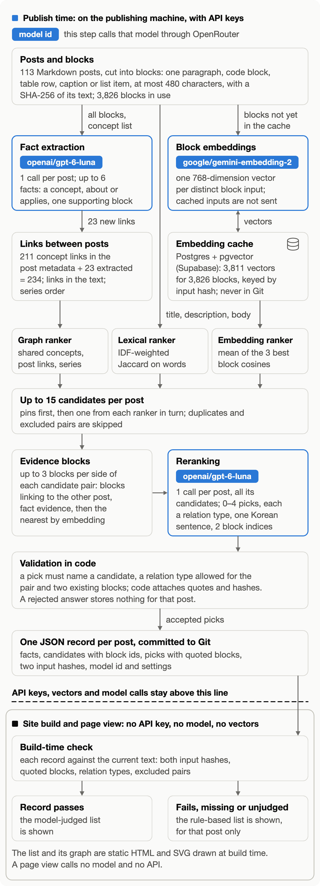</a>

*Figure 4. The pipeline. The three boxes with a blue outline are the only steps that call a model. Everything below the dashed line runs without API keys, vectors or a model. It reads only the records and the current text of the posts.*

Each post is first cut into blocks. A block is one paragraph, code block, table row, figure caption or list item, and an element longer than 480 characters is split into several blocks. Each block is stored with a SHA-256 hash of its text. Blocks under a references heading are dropped, which leaves 3,826. A block is embedded together with the article title and its section heading. Identical inputs share a vector, so the 3,826 blocks need 3,811 vectors.

Fact extraction is one call per post. The model receives the title, the concept links from the metadata, the dictionary of all 51 concepts and every block, and returns up to six facts, each a concept, a role (`about` or `applies`) and the index of one block that supports it. Keeping the supporting passage with each extracted relation follows the way DocRED annotates relations with evidence sentences (Yao et al., 2019). The 113 records hold 214 facts on 107 posts. Of these, 185 repeat a link in the metadata, 23 add a concept that the metadata did not link and 6 propose a different role, in which case the role in the metadata is kept.

Three of the 113 posts are Korean stubs whose body is at most ten characters of text (one is a single image). They have no passage to quote, so neither LLM step is run for them. We call them the three stub posts below.

Everything else in Figure 4 is plain code: the three rankers, the choice of evidence blocks, the validation of the model's answer, the build-time check and the page itself. Vectors never enter Git, the build or the browser.

## 4. Candidate retrieval {#candidates}

The rule-based list on the old site was the top four articles of a scorer that we call the graph ranker. It scores shared concepts, links between posts and series order. Seven broad concepts, such as Model Fine-Tuning or Python Language Features, are down-weighted and cannot link two posts on their own. Using only the concept links in the metadata, the graph ranker produced fewer than 10 candidates for 79 of 113 posts and none for 11, too few to give a reranker a choice. We added two rankers that need no concept links:

- a lexical ranker, IDF-weighted Jaccard similarity over the words of the title, description and body;
- a block-embedding ranker, where each block of the source is matched to its most similar block in the target and the pair's score is the mean of the three best cosines.

The candidate list takes pinned articles first (pins are set by hand, and there are none so far) and then one article from each ranker in turn, skipping duplicates and pairs excluded by hand, until it holds 15. This gave 15 candidates for 103 of 113 posts and 1,642 candidate pairs in all.

For this article we measured what each ranker contributes, using the audit verdicts of Section 7 as reference labels (LLM-agent judgments, not ground truth): the 202 distinct pairs, in the model's lists or the rule-based lists, that a judge rated as a specific reason to read next.

[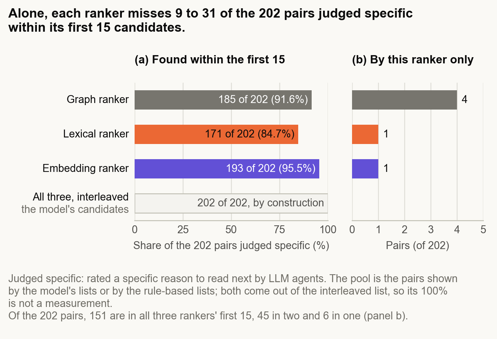](../assets/research/related-articles-graph/figures/fig_candidate_recall.png)

*Figure 5. (a) Pairs judged specific that each ranker has within its first 15 candidates, out of 202. (b) Pairs that only that ranker has. The verdicts are those of LLM agents. The bottom bar of (a) is 202 of 202 by construction, not a measurement.*

Alone, the graph ranker had 185 of the 202 pairs in its first 15 (91.6%), the lexical ranker 171 (84.7%) and the embedding ranker 193 (95.5%). All three lists contained 151 of the pairs, and two of them contained another 45. The other 6 were in one list only: 4 in the graph ranker's, 1 in the lexical ranker's and 1 in the embedding ranker's (Figure 5b). Interleaving only two of the rankers kept 191 of 202 without the graph ranker, 200 without the lexical one and 201 without the embedding one.

The pool limits what these numbers say. It contains only pairs that the model's lists or the rule-based lists showed, and both were drawn from these same candidates. Pairs that neither list showed were never judged, and the pool favors the graph ranker because the rule-based lists are its top four.

Agreement between rankers tracked the verdicts on the model's 243 picks (Table 3). No pick that all three rankers had in their first 15 was judged unrelated, and 9 of the 12 unrelated picks had been proposed by one ranker only. Of the 34 single-ranker picks, 16 came from the graph ranker (4 judged unrelated), 13 from the embedding ranker (4 unrelated) and 5 from the lexical ranker (1 unrelated).

| Rankers with the pick | 3 | 2 | 1 |
|---|---|---|---|
| Picks | 142 | 67 | 34 |
| Specific | 116 | 37 | 5 |
| Same field only | 26 | 27 | 20 |
| Unrelated | 0 | 3 | 9 |

*Table 3. Verdicts on the model's 243 picks, before any audit-driven correction, by the number of rankers that had the pick in their first 15. Judged by LLM agents.*

## 5. Evidence blocks and the reranking call {#rerank}

For every candidate pair the code selects up to three blocks from each article, the evidence blocks: first blocks that link to the other article, then the supporting blocks of facts on a concept the two articles share, then the blocks most similar to the other article by embedding, preferring blocks from different sections.

Reranking is one call per post. The request holds all candidates with their blocks (about 20,600 characters on average), and the answer is a list of 0 to 4 picks, best first. Each pick gives the target, a relation type, one Korean sentence and the index of one block on each side. An empty list is a valid answer, and 14 posts got one.

One stored pick goes from the English article [Evaluation Pitfalls in an In-Browser Book-Spine Reader](/research/in-browser-spine-reader) to the Korean note [(LLM-University) 1-4. Reranking](/nlp/2024/11/12/reranking.html):

- Type: `concept_explanation`
- Reason: 「후보 책을 문자열 유사도와 규칙으로 재채점하는 과정이 reranking의 관련성 점수 부여와 어떻게 연결되는지 배울 수 있습니다.」 ("You can learn how rescoring candidate books with string similarity and rules connects to the relevance scoring that reranking performs.")
- Source passage: "Matching normalizes the query, retrieves 50 candidates from a 50,000-book dictionary with character 2-gram and 3-gram BM25, and rescores them with string similarity plus a few rules [...]"
- Target passage: 「Reranking은 다음과 같이 작동합니다: 각 (쿼리, 응답) 쌍에 대해 관련성 점수를 부여합니다. [...]」 ("Reranking works as follows: it assigns a relevance score to each (query, response) pair.")

The model returned the type, the sentence and two block indices. The code attached the two passages and their hashes.

The code rejects an answer with more than four picks, a target that is not a candidate, a repeated target, a relation type not allowed for that pair, a block index that does not exist, an empty or overlong sentence, or a sentence that has no Hangul or contains Japanese kana. The allowed targets, relation types and index ranges are also written into the JSON schema sent with the request. A rejected answer counts as a failed call for that post. Until the next run the post keeps its earlier picks if their passages still exist and shows the rule-based list otherwise. None of the 33 requests in the test runs of Section 6.2 was rejected. For the two full passes we did not record how many were; no record stored after them is marked as a failed call.

These checks guarantee that a stored pick names a real candidate and two passages that exist word for word in the current articles. Nothing in the pipeline checks whether the sentence is true of those articles (Section 7.3).

## 6. Records and incremental updates {#records}

### 6.1 One record per article {#record}

The output is one JSON file per article, committed with the posts: the article's facts with their quoted blocks, the candidates and block lists sent to the model, the picks with their quoted blocks, two input hashes and the model id with its settings. We used files in the repository and not a database table so that the site build can read them without credentials and a changed recommendation shows up as a diff next to the post that caused it. The vectors are the only data in a database, and they are a cache that can be recomputed.

Each hash decides whether a model call is needed. The extraction hash covers the model id, the seed and reasoning setting, the extraction instruction, the title, the concept links from the metadata and the hashes of the article's blocks. It leaves out the concept dictionary, so that editing one concept does not force every post to be extracted again. The reranking hash covers the model id, the same settings, the reranking instruction and, for each candidate, its title, the roles on shared concepts, the allowed relation types and the hashes of the selected blocks on both sides. It leaves out candidate order and scores, so a reshuffle inside the 15 costs nothing. A post is reranked when an article enters or leaves its 15 candidates or when a selected block changes.

The build cannot recompute candidates, because that needs the vectors. It recomputes the extraction hash from the current text, and the reranking hash from the candidate and block lists stored in the record together with the current text of those blocks. It also requires that every quoted passage still equals its block, that every target is still public and not excluded, and that every relation type is still allowed. An edited or deleted passage is caught at build time. A change in which articles would now be candidates is caught only at publish time. A record that fails sends that one post back to the rule-based list. Among the 113 posts, 110 show a model-judged list and the three stub posts show the rule-based list.

### 6.2 What a new post costs {#new-post}

<a href="../assets/research/related-articles-graph/figures/fig_new_post.png">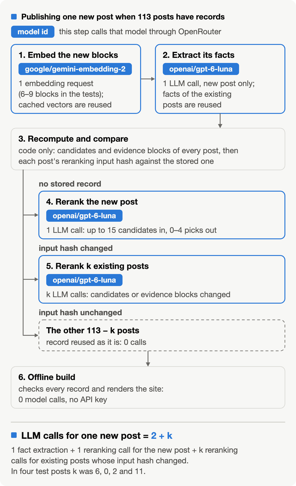</a>

*Figure 6. Publishing one post. The dashed box is the part that costs nothing: records whose input hash is unchanged are reused as they are.*

A new post needs one extraction call and one reranking call for itself. The code then recomputes candidates and evidence blocks for every post and reranks only the k existing posts whose hash changed, so the total is 2 + k LLM calls (Figure 6). Changing the model, its seed or its reasoning setting changes every hash and costs two calls per post. Changing one of the two instruction texts reruns only that step: the sentence about language that we added to the reranking instruction (Section 7.3) cost one reranking call per post and no extraction call.

We tested this with four hypothetical posts written for the test (Figure 7). For each one, the links it should get (expected links) and the links it should not get (forbidden links) were written down before any model call. An LLM agent chose them from the article texts; no human set them. Each post was added alone to the 113 posts and then taken out again. The tests ran on the output of the first full pass, before the audit and before the language check of Section 7.3 existed.

[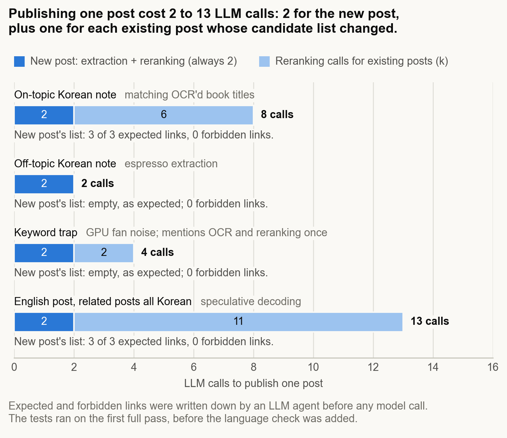](../assets/research/related-articles-graph/figures/fig_scenarios.png)

*Figure 7. LLM calls for four hypothetical posts. The line under each bar refers to the new post's own list, measured against links that an LLM agent had chosen in advance.*

A Korean note on matching OCR output to book titles cost 8 calls and got its three expected links. A note on espresso extraction and a note on GPU fan noise that mentions OCR and reranking once in passing cost 2 and 4 calls, and both got an empty list as expected. An English post on speculative decoding whose related posts are all Korean cost 13 calls and got its three expected links, with Korean reason sentences. No new post's list contained a forbidden link. Removing the first test post afterwards took 6 reranking calls and no extraction call.

This post is a larger case than any of the four. It has about 140 blocks and names or quotes many other posts. A dry run on its final draft, which embeds the new blocks and compares hashes without calling the LLM, listed 18 existing posts whose candidates would change, so publishing it was expected to cost 2 + 18 calls.

In two of the four runs, the new list of a reranked existing post linked two articles that we had judged unrelated in an earlier trial on three posts: the book-spine article and [KoDistill-VL-2B: Korean OCR Post-Training on a Single GPU](/research/kodistill-vl-2b/). Both involve Korean OCR, and neither is useful reading after the other. Nothing excluded the pair at that point, and the first full pass had recommended it in one direction as well. It is now excluded in both directions. After the first test post was removed again, the six records that had been reranked differed from the versions stored before it was added, so a fixed seed did not give us repeatable output.

## 7. Audit {#audit}

### 7.1 Judges and procedure {#judges}

The judges were LLM agents (Claude Fable 5.2), not a human reader. They judged the 113 articles in one pass, in 12 batches of up to 10 articles. For each article the judge was given the model's picks with their reason sentences and quoted passages, the rule-based list with the fixed label each rule attaches (for example "the next article in the same series") and the candidates the model had not picked. It read the full text of the article and of each recommended article. The two lists were labeled by system, so the comparison was not blind.

The judge rated every recommendation of both systems as a specific reason to read next, the same broad field only or unrelated. For the model's picks it also rated whether both articles support the reason sentence and whether the sentence states something false. Per article it said which list was the better set of next reads and named articles the model's list had missed.

Every pick rated unrelated or false in that pass went to a second agent that read both articles again: 20 picks, of which 12 were rated unrelated and 10 had a sentence rated false, 2 of them both. The second agent upheld all ten false sentences and changed three verdicts. It moved one pick from same field only to unrelated and one from unrelated to same field only, and it raised one sentence from partly supported to supported. The two moves cancel, so the totals of the three categories reported below are the same before and after this check. No other pick was judged twice, so we have no measure of agreement between judges.

Picks that the model produced after the first exclusions were judged in two later rounds, on the 13 and then the 3 posts that had been reranked. For those rounds we kept only totals, not the verdict on each pick.

### 7.2 Results {#results}

[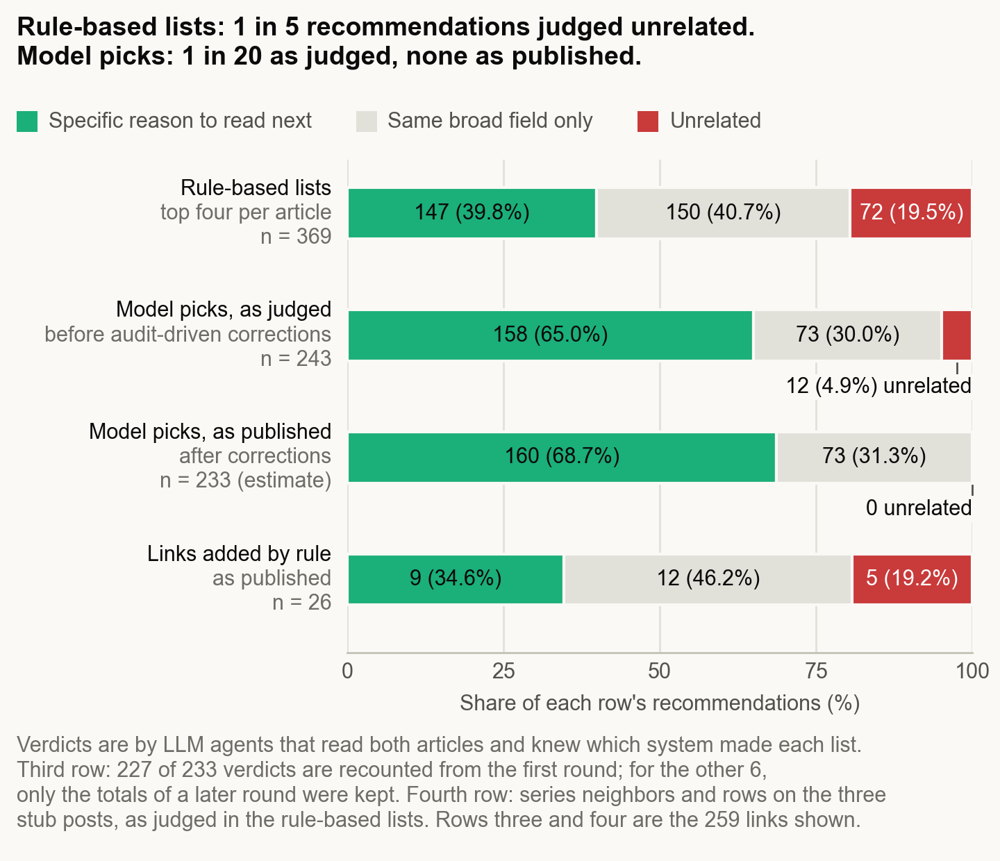](../assets/research/related-articles-graph/figures/fig_audit.png)

*Figure 8. Verdicts on every recommendation, by LLM agents that knew which system had made each list. The third row is an estimate: 227 of its 233 verdicts are recounted from the first judging round, and for the other 6 only the totals of a later round were kept. The fourth row is the 26 links that rules add to the published lists (Section 7.4), with the verdicts they received as part of the rule-based lists.*

The rule-based lists held 369 recommendations: 147 specific (39.8%), 150 same field only (40.7%) and 72 unrelated (19.5%). The model's lists, before any correction based on the audit, held 243: 158 specific (65.0%), 73 same field only (30.0%) and 12 unrelated (4.9%). The model recommended fewer links, 243 against 369, and 85 of them fell in the two weaker categories, against 222 for the rule-based lists (the first two rows of Figure 8).

[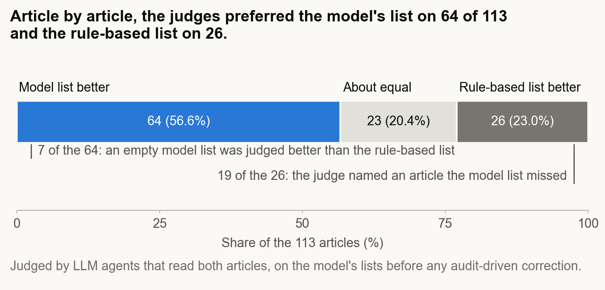](../assets/research/related-articles-graph/figures/fig_per_article.png)

*Figure 9. Which list the judge preferred, per article, for the model's lists before any audit-driven correction. Judged by LLM agents that knew which list was which.*

Per article, the judge preferred the model's list on 64 of 113, found the two about equal on 23 and preferred the rule-based list on 26 (Figure 9). In 7 of the 64, an empty model list was judged better than the rule-based list. In 19 of the 26, the judge named a specific article the model's list had missed, and in 6 of those the missed article was another part of the same series.

### 7.3 False sentences, wrong language, unrelated picks {#failures}

Ten of the 243 reason sentences (4.1%) stated something that one of the articles does not say. One belongs to the pick from [(vLLM) When set `-tp>2` option, Not working inference](/developing/2025/03/13/vllm-inference-not-working.html) to [사내 LLM 추론 서버 구축기](/developing/2026/11/11/inner-llm-inference-server.html) (a build log of an in-house LLM inference server). The link is right: both describe the same hang. The sentence read 「다중 GPU 추론에서 NCCL_P2P_DISABLE와 --disable-custom-all-reduce를 함께 적용했을 때의 정지 증상을 비교해 볼 수 있습니다.」 ("You can compare the hang seen when NCCL_P2P_DISABLE and --disable-custom-all-reduce are applied together in multi-GPU inference.") In the articles, applying both is the fix, and the hang occurred with only the first one set.

The wrong language appeared earlier. On the first full pass, the book-spine article of Section 5 received all four of its reasons in Japanese, for example 「候補を文字列類似度などで再採点する本の照合処理を、rerankingの基本的な仕組みと結び付けて理解できます。」 ("You can understand the book-matching step, which rescores candidates by string similarity, by connecting it to the basic mechanism of reranking.") The instruction already asked for one short Korean sentence. We added a sentence naming the language to the instruction, added the Hangul and kana check of Section 5 and reranked every post. The 243 picks that were judged are the output of that second pass.

The two passes differed by more than the language. The first pass had 215 picks. Of those pairs, 170 reappeared among the 243 of the second pass, each with a differently worded sentence, 45 did not reappear and 73 pairs were new. Between the passes we had added one sentence to the instruction, which concerned only the language, and excluded the pair of Section 6.2.

Twelve of the 243 picks were judged unrelated. One linked a note on a single regular-expression substitution to the book-spine article with a sentence about how each handles whitespace and punctuation. Both quoted passages were real, and cleaning up text is all the two articles share.

Excluding a pair did not end the problem. After the first round of exclusions the affected posts were reranked, and the model filled the freed places with 8 new picks. The judges rejected 5 of them.

### 7.4 Corrections and the published lists {#shipped}

Three controls turned the judged output into the published lists. First, an exclusion list holds 22 directed pairs that are removed from the candidates before the model sees them: the two directions of the pair from Section 6.2, 15 pairs from the first audit round and the 5 rejected replacements. Second, four reason sentences whose link was right and whose claim was wrong were rewritten by hand. A hand-written sentence is stored apart from the record, keyed by the pair, and replaces the model's sentence when the site is built. It survives a rerank as long as the model still picks the pair, and the record keeps the model's sentence. Third, the previous or next part of a series is appended by rule when the graph ranker has it in its top four and the list has fewer than four entries, which added 20 links.

Of the 243 judged picks, 227 are in the published records. The other 16 are the 12 picks judged unrelated (3 of them also had a false sentence, counting the pick that the second check moved into this group), 3 same-field picks with a false sentence and 1 same-field pick that the model did not return when its post was reranked. Six published picks were not among those 243: 3 of the 8 first-round replacements and 3 that appeared when three posts were reranked after the second round of exclusions. That makes 233, the picks whose relation types are shown in Figure 10b.

[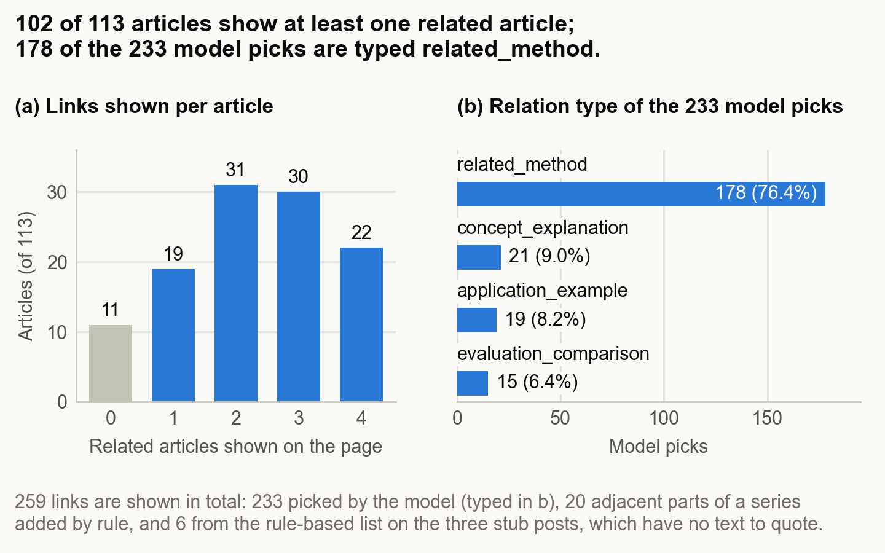](../assets/research/related-articles-graph/figures/fig_records.png)

*Figure 10. What is published. (a) Related articles shown per article; 11 of 113 show none. (b) Relation type of the 233 model picks.*

The later judging rounds left totals for the published model picks: 160 specific, 73 same field only and none unrelated. Of these 233 verdicts, 227 can be recounted from the first round (158 specific and 69 same field only) and the other 6 cannot, which is why the third row of Figure 8 is an estimate.

As displayed, none of the ten sentences that the judges flagged remains. Six were removed together with their excluded pairs, and four are replaced by the hand-written sentences, which no judge rated. Of the 233 model sentences, 21 were judged only in the later rounds: 15 that the model reworded when their post was reranked and the 6 on new picks. The totals kept from those rounds report no false sentence.

Readers see 259 links: the 233 model picks, 20 series neighbors and 6 entries from the rule-based lists of the three stub posts. The 26 links added by rule were judged as part of the rule-based lists: 9 specific, 12 same field only and 5 unrelated (the fourth row of Figure 8). The 5 unrelated ones, 3 series neighbors and 2 entries on stub posts, are still displayed.

Of the 113 posts, 102 show at least one related article and 11 show none (Figure 10a), and 21 are linked from no other post's list (26 if only model picks are counted). Of the 233 picks, 178 (76.4%) are typed `related_method`, one of the two types that are always allowed, and the two types that depend on concept roles account for 40 (Figure 10b).

A new post gets no audit. Its list should be expected to look like the uncorrected output, in which 4.9% of picks were judged unrelated and 4.1% of sentences false. Those rates come from one judged pass, and we did not measure how much they vary from run to run.

## 8. The graph and the outline on the page {#graph}

### 8.1 Drawing the graph {#graph-layout}

The reranker returns its picks best first, without a numeric score, so rank is the only measure of strength there is to draw. Edge length encodes it: 46, 64, 82 and 100 units for ranks 1 to 4.

The second hop, the article on the dashed edge in Figure 2, is limited to one node. The code walks the recommended articles best first, and the first one whose own list contains an article not yet drawn contributes that article. Its dashed edge takes the length of its rank in that list. A graph is drawn for 102 posts, and 94 of them show a second-hop node.

The layout is computed at build time and shipped as static SVG, and the blog's index page of all articles offers the same graph in a popup (Figure 11). A test enumerates all 44 possible shapes: one to four recommended articles, with no second-hop node or with one on any of them at any of the four lengths (5 + 9 + 13 + 17 = 44). It checks that every node is at least 20 units from the edge of the box, any two nodes are at least 40 units apart, every edge passes at least 14 units from any node that is not its endpoint, no two edges cross and each edge has the length of its rank.

*Figure 11. The graph in a popup on the blog's index page (dark theme), opened from the button at the right of an article's card. This article has three recommendations and one second-hop node.*

### 8.2 The outline {#outline}

The same rebuild added the left column of Figure 1. The outline is a tree in which each second-level heading owns the third-level headings under it. In the desktop sidebar only the branch being read is open, and a meter under the tree shows the fraction of the article body scrolled past and an estimated reading time. On screens narrower than 1,280 px the outline becomes a collapsible block between the title and the article body that lists every heading and shows the reading time without the meter (Figure 12). Reading time is computed at 500 characters per minute for Korean and 230 words per minute for English, with code blocks left out.

[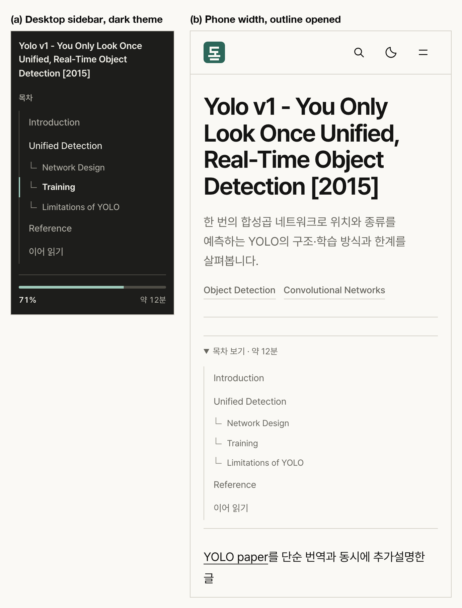](../assets/research/related-articles-graph/figures/shot_outlines.png)

*Figure 12. The outline. (a) The desktop sidebar: the heading tree with the current branch open and, under it, the progress bar, the percentage read and the estimated reading time. (b) At phone width the outline is a collapsible block between the title and the body, shown here opened: every branch is listed and the summary line gives the reading time.*

## 9. Cost {#cost}

Token counts were logged only for the test runs of Section 6.2. Publishing the four test posts made 27 LLM requests with 199,973 input and 4,172 output tokens. At the list prices of Table 1 that is about $0.022 in total and between $0.0009 (2 calls) and $0.0112 (13 calls) per post. The removal made 6 more requests with 53,474 input and 1,273 output tokens.

These figures are logged token counts multiplied by list prices, not billed amounts, and we did not check whether the logged output count includes reasoning tokens. They cover the LLM only. Each test post also needed one embedding request for 6 to 9 new blocks (468 to 1,262 tokens), which at the price of Table 2 adds at most $0.0003. The test posts were short: the blog's posts average about 34 blocks, and the extraction call receives every block, so that call is larger for a real post.

For the two full passes over 113 posts we saved neither token counts nor the billed amount, so we report no cost for them.

## 10. Limitations {#limitations}

- The judges were LLM agents that knew which system had produced each list and saw the model's sentences and quoted passages. Their verdicts were not checked against a human reader, apart from our own rejection of one pair.
- The row for the published model picks in Figure 8 is partly reconstructed, because the later judging rounds left totals and not the verdict on each pick. The four hand-written sentences were not judged.
- No step checks whether a reason sentence is true of the two articles. The ten false sentences were found only by the audit (Section 7.3).
- The audited rates describe one pass of a model whose picks changed widely between two passes after one sentence was added to the instruction (Section 7.3), and whose output was not repeatable with a fixed seed on unchanged input (Section 6.2).
- The candidate measurement in Section 4 uses a pool drawn from the candidates themselves and cannot say how many pairs worth recommending all three rankers miss.
- The audit, the exclusions and the rewritten sentences were all made on the same 113 posts. The test posts of Section 6.2 were written for the test, and an LLM agent set their expected links.
- `related_method`, one of the two types allowed for any pair, accounts for 178 of 233 picks, so the typed relations add less information than the ontology suggests.
- Reason sentences are Korean on every page, including the English articles.

## References {#references}

- Miles, A., & Bechhofer, S. (2009). [SKOS Simple Knowledge Organization System Reference](https://www.w3.org/TR/skos-reference/). W3C Recommendation.
- OpenRouter. [GPT-6 Luna](https://openrouter.ai/openai/gpt-6-luna).
- OpenRouter. [Gemini Embedding 2](https://openrouter.ai/google/gemini-embedding-2).
- Supabase. [pgvector: Embeddings and vector similarity](https://supabase.com/docs/guides/database/extensions/pgvector).
- Yao, Y., Ye, D., Li, P., Han, X., Lin, Y., Liu, Z., Liu, Z., Huang, L., Zhou, J., & Sun, M. (2019). [DocRED: A Large-Scale Document-Level Relation Extraction Dataset](https://aclanthology.org/P19-1074/). ACL 2019.
