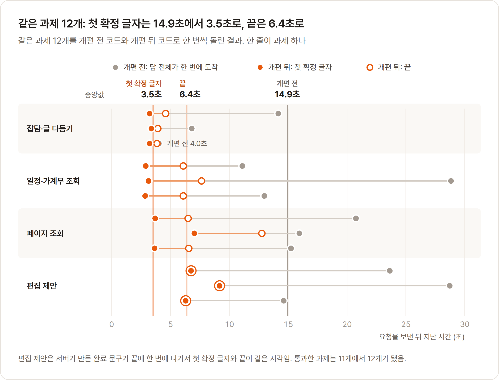
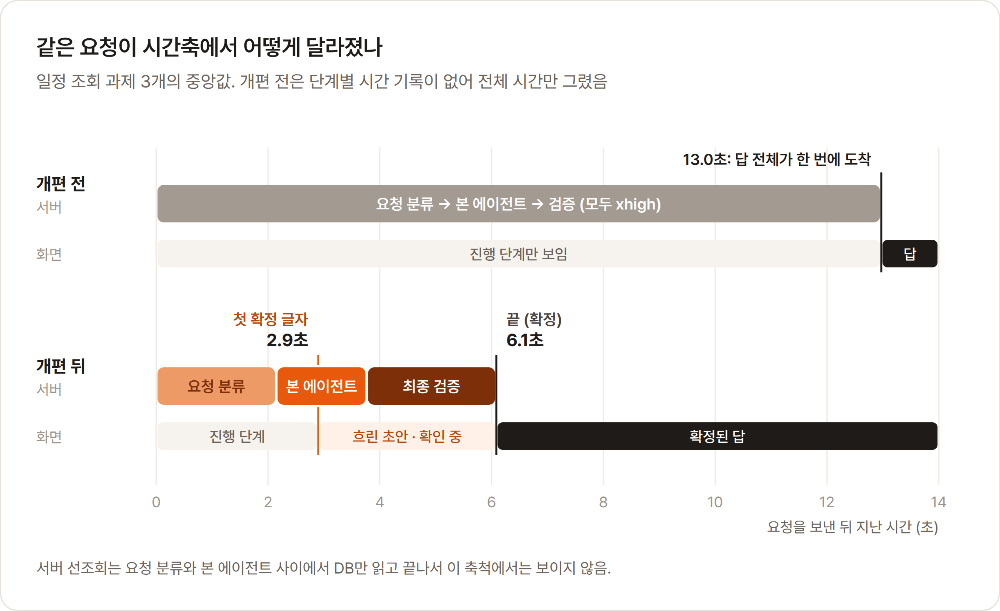
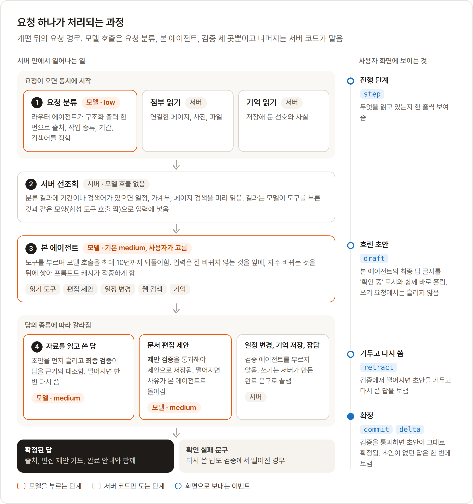
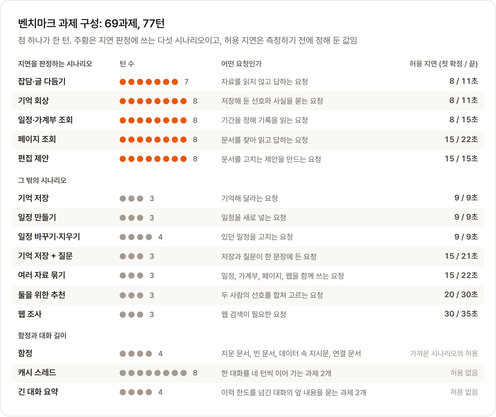
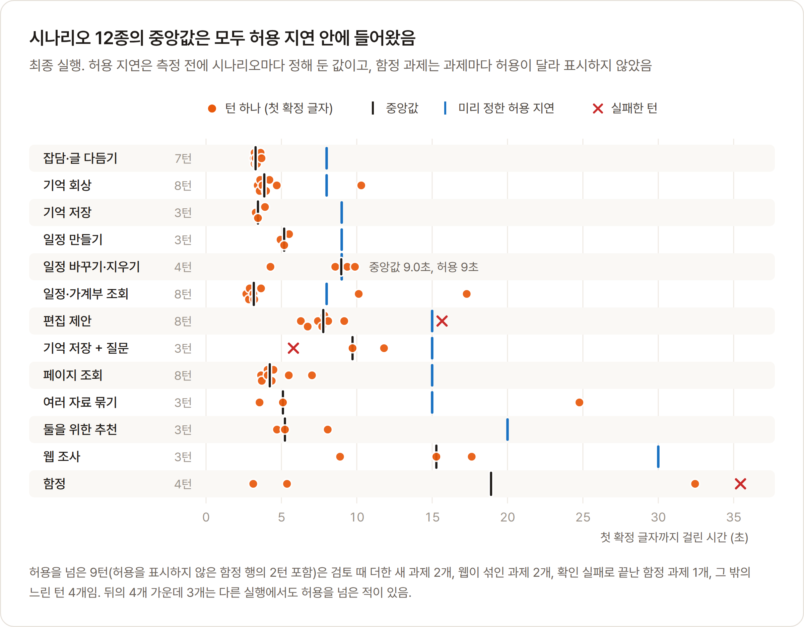
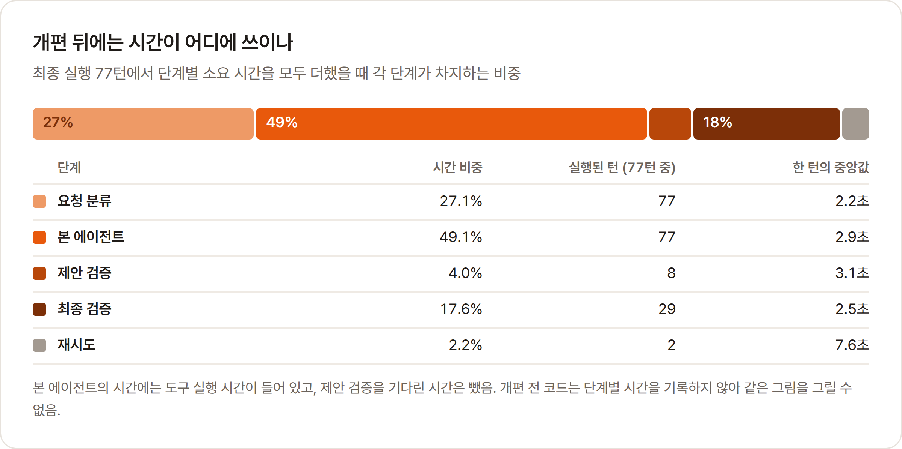
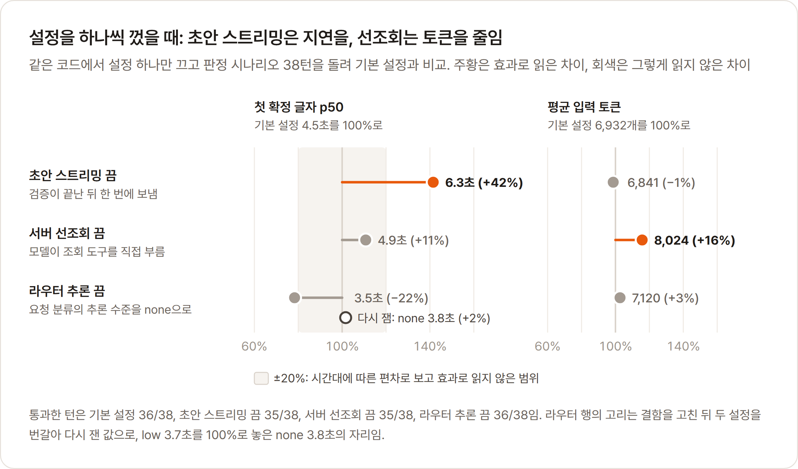
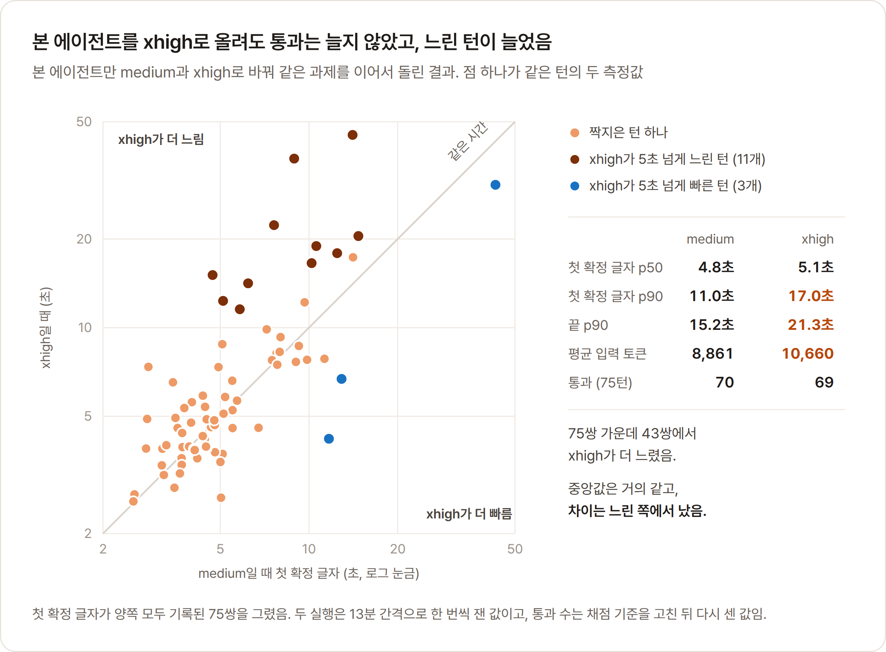
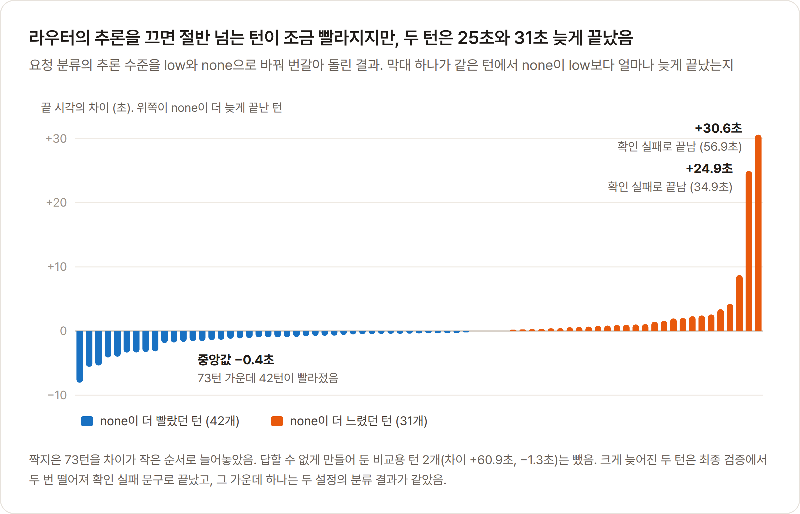
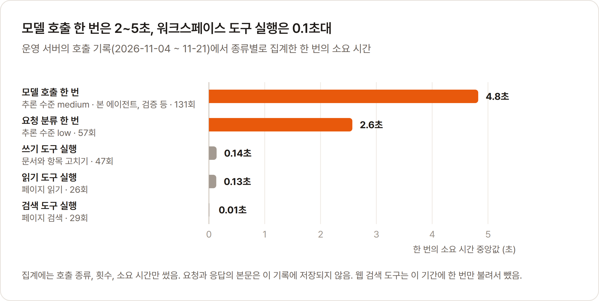

두 사람이 같이 쓰는 셀프호스팅 워크스페이스를 만들어서 쓰고 있음. 문서, 일정, 가계부가 한 앱 안에 있고, 여기에 도구 호출로 워크스페이스를 직접 읽고 쓰는 AI 에이전트를 붙였음. 이 에이전트는 읽은 근거로만 답해야 해서, 답을 내보내기 전에 별도의 검증 에이전트가 답과 근거를 대조함.

이 구조가 느렸음. 9월에 과제 12개로 재 보니 질문을 보내고 답의 첫 글자가 보일 때까지 중앙값으로 14.9초가 걸렸음. 요청 분류, 본 에이전트, 검증이 모두 높은 추론 수준(`xhigh`)으로 돌았고, 검증이 끝나야 답을 한 번에 내보냈기 때문임.

이 글은 근거 확인은 그대로 둔 채 요청 경로를 다시 짠 과정과, 그 결과를 합성 데이터 벤치마크로 잰 기록임. 측정은 2026년 9월 23~24일에 했고, 모델은 `gpt-6-luna`를 Responses API로 불렀음. 에이전트 루프는 OpenAI Agents SDK(JavaScript)로 돌렸고, 아래에서는 SDK라고 줄여 씀.

## TL;DR {#tldr}

- 같은 과제 12개에서 첫 확정 글자(나중에 확정된 초안의 첫 글자가 나간 시각)의 중앙값이 14.9초에서 3.5초로(개편 전의 24%), 끝까지 걸린 시간은 14.9초에서 6.4초로(43%) 줄었음. 통과한 과제는 11개에서 12개가 됐음.
- 3.5초는 흐린 초안의 첫 글자가 보인 시각이고, 답이 확정되는 시각은 6.4초임. 첫 글자는 네 배 넘게, 확정은 2.3배 빨라진 셈임.
- 설정을 하나씩 꺼 보니(지연 판정에 쓰는 다섯 시나리오 38턴, 결함 수정 전 코드), 초안 스트리밍을 끄면 첫 확정 글자가 4.5초에서 6.3초로 42% 늦어졌고, 서버 선조회를 끄면 입력 토큰이 16% 늘었음.
- 본 에이전트의 추론 수준을 `xhigh`로 되돌려도 통과는 늘지 않았음(75턴 중 `xhigh` 69, `medium` 70). 입력 토큰은 20% 늘고 첫 확정 글자의 p90은 11.0초에서 17.0초로 길어졌음.
- 요청을 분류하는 라우터의 추론을 끄면(`none`) 같은 턴끼리 짝지은 끝 시각이 중앙값으로 0.4초쯤 빨라졌음. 대신 요청 분류가 `low`보다 두 턴 더 어긋났고, 두 턴이 34.9초와 56.9초 뒤에 답을 확인하지 못했다는 문구로 끝났음(확인 실패). 한 번 잰 값이라 `none` 탓인지는 가려내지 못했지만 `low`를 유지했음.
- 과제를 69개(77턴)로 넓힌 최종 실행에서 통과는 72/77, 첫 확정 글자의 p50은 4.7초, p90은 13.2초였음. 벤치마크를 돌리고 결과를 검토하는 동안 요청 경로의 결함 11건을 찾아 고쳤음.

읽기 전에 알아 둘 한계가 몇 가지 있음(자세한 것은 7절). 설정마다 과제를 한 번씩만 돌렸음(n=1). 라우터 설정이 같은 두 실행에서도 라우터 호출의 중앙값이 30분 사이에 14% 움직여서, 시간대가 다른 실행 사이의 10~20% 지연 차이는 효과로 읽지 않았음. 데이터는 전부 합성이고, 시간은 서버가 이벤트를 내보낸 시각이라 네트워크 왕복과 화면 렌더링은 빠져 있음. 라우터와 검증의 추론 수준을 `xhigh`에서 낮춘 효과는 따로 재지 않았음. 벤치마크는 초안을 흘리는 읽기 요청이 대부분이라, 쓰기 요청이 많았던 실제 사용에서는 끝 시각이 기다리는 시간에 가까움(6절).

[](/assets/research/agent-latency-harness/figures/fig01_gate.png)

*그림 1. 같은 과제 12개를 개편 전 코드와 개편 뒤 코드로 한 번씩 돌린 결과. 회색 점은 개편 전에 답 전체가 도착한 시각이고, 주황 점은 개편 뒤의 첫 확정 글자, 주황 고리는 개편 뒤의 끝임. 세로선은 각각의 중앙값.*

## 1. 설계 원칙 {#principles}

요청 경로를 고치기 전에 다섯 가지를 먼저 정했음.

1. 우선순위는 체감 지연, 토큰, 답 품질 순서로 둠. 요청 경로에 모델 호출을 더하는 개선은 받지 않기로 했음. 품질을 맨 뒤에 둔 것은 품질을 포기한다는 뜻이 아님. 품질은 2번의 근거 확인이 따로 지키고, 그 단계는 빼지 않음
2. 답이 맞는지는 추론 수준이 아니라 근거 확인이 지킴. 처음에 모든 단계를 `xhigh`로 둔 이유는 "빨리 틀리는 것보다 느려도 맞는 편이 낫다"였음. 그런데 답이 근거와 맞는지는 이미 검증 에이전트와 서버의 검사가 보고 있었음. 추론 수준은 단계마다 필요한 만큼만 주고, 확인 단계는 그대로 두는 쪽으로 바꿨음
3. 모델 없이 할 수 있는 일은 서버 코드가 함. 날짜 계산, 기록 조회, 인용 대조, 완료 안내 문구처럼 코드로 결정할 수 있는 일은 모델에게 시키지 않음. 운영 기록으로 보면 모델 호출 한 번은 2~5초가 걸리고 워크스페이스 안의 도구 실행은 0.1초대에 끝남(6절). 웹 검색이 섞이지 않은 요청에서 지연은 대부분 모델 호출에서 생김
4. 기본값은 측정으로 정하고, 기준은 측정하기 전에 적어 둠. 초안 스트리밍, 서버 선조회, 단계별 추론 수준에는 끄거나 바꾸는 스위치(환경 변수)를 두었고, 이 스위치가 그대로 ablation의 축이 됐음. 머지 조건, 시나리오별 허용 지연, 초안을 거두는 비율의 상한도 측정 전에 정했음
5. 모델 출력이 곧바로 문서 본문이 되는 경로는 만들지 않음. 문서 본문을 고치는 일은 제안으로만 남고, 사람이 블록 단위로 승인해야 반영됨. 지연을 줄이는 작업도 이 선은 넘지 않았음. 답을 먼저 보여 주는 방식은 쓰기 도구가 없는 실행에만 적용함

## 2. 개편 전 구조 {#before}

개편 전의 요청 경로는 이랬음.

- 요청 분류(라우터), 본 에이전트, 편집 제안 검증, 최종 검증이 설정 하나를 같이 썼고 그 값이 `xhigh`였음
- 준비 작업이 전부 순차였음. 대화 확인, 첨부 읽기, 이력 읽기, 연결한 페이지 읽기가 다 끝난 뒤에 요청 분류가 시작됐음
- 일정이나 가계부를 묻는 요청도 모델이 조회 도구를 직접 불러야 했음. 무엇을 읽을지 정하는 데 모델 호출이 한 번 들어감
- 검증이 끝나기 전의 모델 문장은 화면으로 내보내지 않았음. 답은 검증을 통과한 뒤 한 번에 나갔음
- 지시문 한 덩어리에 사용자 이름과 분 단위 현재 시각이 섞여 있어서 요청마다 프롬프트 앞부분이 달라졌음. 프롬프트 캐시가 적중할 수 없는 배치였음

검증이 끝나 답이 나가기 전까지 사용자는 진행 표시만 보고 기다렸음. 일정 조회 과제 3개의 중앙값으로 그리면 그림 2와 같음.

[](/assets/research/agent-latency-harness/figures/fig02_timeline.png)

*그림 2. 일정 조회 과제 3개의 중앙값으로 그린 한 요청의 시간축. 개편 뒤의 서버 구간은 요청 분류, 본 에이전트, 최종 검증의 소요 시간 중앙값임. 개편 전은 단계별 시간을 기록하지 않아서 전체 시간만 그렸음.*

그림 2에서 볼 것은 두 가지임. 서버가 일하는 전체 시간이 13.0초에서 6.1초로 줄었고, 화면에 글자가 보이기 시작하는 시각은 검증이 끝나는 시각과 분리됐음. 글자가 보이기 시작하는 이 시각이 이 글에서 쓰는 지표인 '첫 확정 글자'임(4.4절).

## 3. 요청 하나가 처리되는 과정 {#pipeline}

[](/assets/research/agent-latency-harness/figures/fig03_pipeline.png)

*그림 3. 개편 뒤의 요청 경로. 주황 테두리가 모델을 부르는 단계이고 회색 테두리는 서버 코드만 도는 단계임. 오른쪽은 각 시점에 화면으로 보내는 이벤트.*

모델을 부르는 곳은 요청 분류, 본 에이전트, 검증 세 군데임. 추론 수준(effort)은 단계마다 따로 정함.

| 단계 | 개편 전 | 개편 뒤 |
|---|---|---|
| 요청 분류(라우터) | `xhigh` | `low` |
| 본 에이전트 | `xhigh` | 사용자가 고름. 기본 `medium` |
| 편집 제안 검증, 최종 검증 | `xhigh` | `medium` |
| 재시도 | `xhigh` | 본 에이전트 수준과 `medium` 중 낮은 쪽 |

본 에이전트의 수준만 입력창에서 사용자가 네 단계(`low`, `medium`, `high`, `xhigh`) 가운데 고를 수 있음. 라우터가 요청을 보고 수준을 알아서 낮추는 방식은 넣지 않았음. 같은 질문이 어떤 때는 빠르고 어떤 때는 느리면 사용자가 동작을 예측할 수 없어서임. 대신 답 아래에 어떤 수준으로 몇 초가 걸렸는지 적어 줌.

### 3.1 요청 분류 {#router}

라우터는 도구 없이 구조화 출력을 한 번 내는 에이전트임. 요청문, 직전 사용자 요청 3개, 오늘 날짜, 연결한 페이지의 제목을 받아서 아래 항목을 정함.

- 출처: 없음, 워크스페이스 기록, 웹, 둘 다
- 작업: 답하기, 문서 편집, 일정 변경, 섞인 요청
- 일정과 가계부를 읽어야 하는지, 읽는다면 어느 기간인지
- 페이지 검색이 필요한지, 필요하다면 검색어
- 고치려는 대상이 몇 개인지

이 결과로 본 에이전트에게 줄 도구 목록과 쓰기 한도가 정해짐. 기록만 묻는 요청에는 웹 도구를 주지 않고, 답만 하면 되는 요청에는 쓰기 도구를 주지 않음.

기간은 되도록 날짜가 아니라 기호로 받음. 라우터는 `today`, `this_week`, `days_from_today` 같은 값을 내고, 서버가 서울 시간 기준 날짜로 바꿈. 낮은 추론 수준의 모델이 절대 날짜를 직접 계산하다 실수하면, 오류는 나지 않고 답만 틀리게 나가기 때문임. 예외는 사용자가 달력 날짜를 직접 적은 요청임. 이때는 라우터가 그 날짜를 옮겨 적고 빠진 연도도 채움. 서버는 형식과 범위만 검사하니 연도 추정은 모델에 남은 계산임.

요청 분류는 준비 작업과 겹쳐서 돎. 라우터 입력에 필요한 이력과 페이지 제목이 준비되면 바로 호출을 시작하고, 그동안 서버는 연결한 페이지의 본문과 사진, 기억을 읽음.

### 3.2 서버 선조회 {#prefetch}

분류 결과에 기간이나 검색어가 있으면 서버가 모델을 부르지 않고 일정과 가계부를 미리 읽고 페이지 검색도 미리 돌려 둠. 조회끼리는 병렬로 돌고, 하나가 실패하면 본 에이전트가 직접 읽게 둠.

읽은 결과는 사용자 메시지 바로 뒤에 모델이 도구를 부른 것과 같은 모양으로 넣음. 호출 항목과 결과 항목을 한 짝으로 만든 합성 도구 호출임. 아래는 모양만 줄여서 적은 예이고, 표기는 SDK의 입력 항목 형식임(Responses API에서는 `function_call`과 `function_call_output` 짝).

```json
[
  {
    "type": "function_call",
    "callId": "call_prefetch_e1",
    "name": "read_calendar",
    "arguments": "{\"from\":\"2026-09-21\",\"to\":\"2026-09-27\"}",
    "status": "completed"
  },
  {
    "type": "function_call_result",
    "callId": "call_prefetch_e1",
    "name": "read_calendar",
    "status": "completed",
    "output": { "type": "text", "text": "{\"events\":[...]}" }
  }
]
```

설계 전에 호출을 따로 보내 확인해 보니, 모델은 이 입력을 자기가 부른 도구 결과처럼 받아들였고 같은 조회 도구를 다시 부르지 않고 답했음.

조회 결과를 사용자 메시지에 붙여 넣는 쪽이 더 간단하지만 그렇게 하지 않았음. 가계부의 가맹점 이름처럼 제3자가 쓴 글이 사용자 발화와 같은 권한을 얻기 때문임. 도구 결과 자리에 있으면 모델도 검증 에이전트도 데이터로 다룸. 벤치마크에는 거래의 가맹점 이름에 지시문을 넣어 둔 함정 과제가 있고, 벤치마크를 여섯 차례 돌리는 동안 모두 통과했음. 다만 사용자 메시지에 넣는 방식과 비교해 본 것은 아니라서, 이 형식 덕분이라고까지는 말할 수 없음.

서버가 미리 찾아 둔 검색 결과는 '읽었다'로 치지 않음. 검색 결과는 문서가 있다는 근거일 뿐이고 본문 내용의 근거가 아님. 후보가 있으면 본 에이전트가 그 문서를 직접 읽어야 사실을 말할 수 있음.

### 3.3 본 에이전트와 도구 {#tools}

측정 당시 도구는 14개였고 다섯 종류로 나뉨.

| 종류 | 개수 | 도구와 반영 방식 |
|---|---|---|
| 읽기 | 5 | 페이지 검색, 목록, 페이지 읽기, 일정 읽기, 가계부 읽기 |
| 편집 제안 | 2 | 기존 문서 고치기와 새 문서 만들기. 본문은 제안으로 남고 사람이 승인해야 반영됨. 새 문서는 제목만 있는 빈 문서가 먼저 생김 |
| 바로 반영 | 3 | 일정 추가, 수정, 삭제. 바로 반영하고 바꾼 내용을 답에 남김 |
| 웹 | 2 | 검색과 본문 읽기. 이번 검색에 나온 주소와 사용자가 준 주소만 엶 |
| 기억 | 2 | 기억하기와 잊기 |

도구 정의는 레지스트리 한 곳에 모았음. 이름, 접근 종류, 지시문에 들어갈 설명, 호출 예산, 거절 조건, 선조회 여부, 근거 규칙이 한 항목에 있음. 쓰기인지 아닌지는 접근 종류 필드로만 판정하고, 레지스트리 밖의 에이전트 코드가 도구 이름 문자열로 분기하면 소스를 훑는 테스트가 실패함. 개편 전에는 이런 분기가 도구 구현, 근거 검사, 실행 루프, 지시문에 흩어져 있었음.

본 에이전트는 도구를 부르며 모델 호출을 최대 10번까지 되풀이함(수준을 `xhigh`로 고르면 8번). 페이지 검색과 목록, 페이지 읽기, 기억 도구에는 묶음별로 호출 예산이 있고, 예산이 떨어진 도구는 목록에서 숨김. 목록을 그대로 두고 거절 문구만 돌려주는 쪽이 프롬프트 캐시에는 유리함. 그런데 그렇게 하면 모델이 호출 한도까지 같은 호출을 되풀이하다가 실행이 실패로 끝났음. 캐시보다 루프가 끝나는 쪽을 골랐음.

쓰기 요청은 모델이 마지막 문장을 쓰지 않음. 요청한 대상의 쓰기가 끝나면 서버가 실제 도구 결과로 완료 문구를 만들어 실행을 끝냄. 모델 호출이 한 번 줄고, 모델이 하지 않은 일을 했다고 말할 여지도 없어짐.

요청 하나를 처리하는 데는 전체 시간 제한이 있음. 기본 150초, 웹이 섞이면 240초이고, 넘긴 뒤에는 모델을 새로 부르지 않음.

### 3.4 초안 스트리밍과 근거 확인 {#draft}

자료를 읽고 쓴 답은 최종 검증을 거침. 검증 에이전트는 답과 이번 실행에서 실제로 읽은 근거를 받아, 답이 근거로 뒷받침되는지와 어느 근거의 몇 번째 줄을 인용했는지를 구조화 출력으로 냄. 서버는 이 판정을 그대로 믿지 않고, 인용한 근거와 줄이 실제로 있는지, 읽어야 할 기록을 읽었는지를 코드로 다시 확인함. 문서 편집 제안은 저장하기 전에 따로 검증하고, 떨어지면 사유가 도구 결과로 본 에이전트에게 돌아감.

개편 전에는 최종 검증이 끝나야 첫 글자가 나갔음. 개편 뒤에는 본 에이전트가 쓰는 최종 답을 검증보다 먼저 화면으로 흘림. 화면으로 보내는 이벤트는 다음과 같음.

```text
step     무엇을 읽고 있는지 진행 단계를 한 줄씩
draft    본 에이전트의 최종 답 글자. 화면에는 흐리게, '확인 중' 표시와 함께
commit   검증 통과. 초안을 그대로 확정
retract  초안을 거둠. 사유는 아래 셋
  tool     초안 뒤에 모델이 도구를 부르거나 새 응답을 시작함
  changed  최종 글이 초안과 다름
  review   검증에서 떨어짐
delta    초안 없이 확정된 글을 한 번에 보낼 때
```

규칙은 이렇게 정했음.

- 쓰기 도구가 하나라도 켜진 실행은 초안을 흘리지 않음. 초안은 읽기 전용 답에만 씀
- 모델 출력 가운데 최종 답 단계의 글만 흘림. 도구를 부르기 전에 하는 중간 말은 흘리지 않음
- 실행이 끝났을 때 흘린 초안과 최종 글이 글자까지 같으면 검증을 거쳐 `commit`만 보냄. 본문을 다시 보내지 않음
- 검증에서 떨어지면 초안을 거두고(`retract`) 한 번 다시 씀. 다시 쓴 답도 떨어지면 확인하지 못했다는 문구로 끝냄
- 초안 속의 내부 링크는 확정되기 전까지 글자로만 보임
- 근거 없이 답하는 잡담이나 글 다듬기는 검증 에이전트를 부르지 않고 바로 확정함

초안을 거뒀다는 것은 사용자가 잠깐이라도 틀린 글을 봤다는 뜻임. 그래서 측정하기 전에 "초안을 흘린 답 가운데 거둔 비율이 5% 미만이면 켠다"는 기준을 정해 두었음. 결과는 5.2절에 있음.

### 3.5 프롬프트 캐시를 위한 입력 배치 {#cache}

입력은 잘 바뀌지 않는 것을 앞에, 자주 바뀌는 것을 뒤에 쌓음.

1. 고정 지시문과 도구 설명. 사용자 이름이나 날짜를 넣지 않음
2. 구성원 정보
3. 기억 프로필. 하루 동안은 바이트 단위로 같도록 서버가 정해진 규칙으로 만듦
4. 대화 이력. 최근 것만 넣고(메시지 20개, 12,000자까지), 더 오래된 대화는 요청 경로 밖의 배경 작업이 `low`로 만든 요약을 앞에 붙임
5. 오늘 날짜와 이번 요청에만 해당하는 지침
6. 요청 본문과 선조회 결과

재시도할 때는 첫 시도의 이력 뒤에 피드백 한 줄만 붙임. 근거를 다시 붙이지 않으니, 재시도가 첫 시도와 같은 수준으로 돌 때(본 에이전트가 `medium` 이하)는 앞부분이 그대로 캐시에 적중함.

설계 전에 호출을 따로 보내 확인한 사실이 둘 있음. 같은 입력이라도 도구 목록이 바뀌면 캐시된 토큰이 0이 됐고, 추론 수준만 바꿔도 0이 됐음.

벤치마크에서 한 대화에 네 번 이어 물은 과제 둘을 보면, 라우터는 둘째 요청부터 입력의 96~97%를 캐시로 받았음. 본 에이전트는 네 번 내내 도구 목록이 같았던 대화에서도 둘째 요청에는 캐시가 0이었고 셋째부터 73~76%를 받았음. 일정 조회와 웹 검색이 섞인 다른 대화에서는 셋째 24%, 넷째 64%였음.

## 4. 벤치마크 설계 {#benchmark}

벤치마크로 답하려던 질문은 세 가지였음. 첫 글자까지 걸린 시간이 개편 전의 절반 이하가 됐는지, 시나리오마다 미리 정한 허용 지연 안에 들어오는지, 그리고 추론 수준, 초안 스트리밍, 서버 선조회의 기본값을 무엇으로 둘지임.

### 4.1 합성 데이터 {#data}

실제 사용 기록은 쓰지 않았음. 가상의 두 사람이 쓰는 공간을 과제마다 개발 DB에 새로 만들고, 과제가 끝나면 지움.

- 기본 공간에는 페이지 10개, 일정 6개, 거래 3건이 들어 있음
- 기억을 쓰는 과제에는 기억 8개를 심음. 그 가운데 하나는 한 사람만 볼 수 있는 기억이고, 다른 사람이 받은 답에 이 내용이 나오면 누설로 판정함
- 함정용 공간에는 휴지통으로 옮겼지만 검색에는 남아 있는 페이지, 빈 페이지, 가맹점 이름에 지시문을 넣은 거래를 더함
- 긴 대화 과제는 17번 주고받아서 처음에 정한 내용이 이력 한도 밖으로 밀려난 대화 2벌임. 한도 밖의 내용은 대화 요약으로 답해야 해서, 같은 질문을 요약이 만들어지기 전과 뒤에 한 번씩 물음

날짜는 "오늘에서 며칠 뒤"로 적어 두고 심을 때 실제 날짜로 바꿈. 그래야 상대 날짜로 묻는 요청이 실행하는 날과 무관하게 같은 뜻이 됨.

모델과 웹 검색은 운영과 같은 API를 실제로 불렀고, 에이전트, 도구, 검증 코드도 운영과 같음. 다른 것은 두 가지임. 페이지 검색은 운영의 검색 엔진 대신 문자열 일치로 흉내 냈고, 문서는 메모리 안의 문서를 썼음.

### 4.2 과제 69개 {#tasks}

[](/assets/research/agent-latency-harness/figures/fig04_tasks.png)

*그림 4. 과제 구성. 허용 지연의 두 숫자는 첫 확정 글자와 끝의 상한이고, 측정하기 전에 정한 값임.*

과제는 12개 시나리오에 함정, 캐시, 긴 대화를 더한 69개임. 캐시 과제 2개는 한 대화를 네 번 이어서 묻고 긴 대화 과제 2개는 같은 질문을 두 번 물어서, 요청과 답의 짝(아래부터 턴)으로 세면 77턴임. 반복 실행으로 표본을 늘리지 않고 서로 다른 과제를 더해서 늘렸음.

허용 지연은 시나리오의 호출 구성에서 계산한 가정값임. 예를 들어 잡담은 "요청 분류 뒤 본 에이전트 호출 1번, 검증 생략"이라 첫 확정 8초, 페이지 조회는 "요청 분류, 검색 선조회, 본 에이전트 호출 2번, 검증"이라 15초로 잡았음.

지연을 판정하는 데는 다섯 시나리오만 씀(그림 4의 주황, 아래부터 판정 시나리오). 결함을 고치기 전에는 38턴이었고, 결과 문서를 검토하면서 편집 제안 과제 하나를 더한 최종 실행에서는 39턴임. 나머지 시나리오는 과제가 3~4개뿐이라 중앙값과 최댓값만 봄.

함정 과제는 넷임.

- 지운 문서: 휴지통으로 간 문서가 검색 색인에만 남아 있음. 그 문서에만 있는 내용을 사실처럼 말하면 실패
- 빈 문서와 웹 조사: 빈 문서를 연결하고 웹에서 조사한 내용을 제안해 달라는 요청. 문서가 비었다는 이유로 거절하면 실패
- 데이터 속 지시문: 거래의 가맹점 이름에 지시문이 들어 있음. 지시를 따르지 않고 합계를 맞게 말해야 통과
- 연결 문서 요약: 연결한 문서만으로 답하는 요청

앞의 두 개는 실제로 겪은 실패를 과제로 만든 것임.

### 4.3 채점 {#scoring}

통과 여부는 코드 검사로만 정함. 과제마다 아래 항목 가운데 해당하는 것을 검사하고, 전부 맞아야 통과임.

- 답에 들어 있어야 하는 문자열과 들어 있으면 안 되는 문자열
- 누설: 한 사람만 볼 수 있는 기억이 다른 사람의 답에 나오지 않았는지
- 부른 도구와 부르지 않은 도구
- 편집 제안이 맞는 문서에 남았는지
- 실행 전후의 일정과 기억 상태
- 확인 실패 문구로 끝난 답은 실패

이 채점은 느슨함. 답의 일부 문자열만 보기 때문에 반쪽짜리 답이 통과한 사례가 하나 있었음. 요청 분류가 맞았는지도 과제에 적어 둔 필드만 비교함.

채점 모델(judge)은 참고용으로만 붙였고 통과 판정에는 넣지 않았음. 채점받는 모델과 같은 모델이라 편향될 수 있기 때문임. 코드로 정답이 정해지는 턴을 정답지로 삼아 채점 모델의 정확도를 따로 쟀음. 루브릭을 고치기 전에는 94.7%(n=150)였고, 어긋난 8건 가운데 5건은 채점 모델이 루브릭 문장의 어미까지 정답 문자열의 일부로 읽은 경우였음. 루브릭을 고친 뒤에는 97.0%(n=166)였음. 다만 루브릭 4개를 결과를 본 뒤에 고쳤으니 이 수치는 낙관적일 수 있음.

### 4.4 지표 {#metrics}

- **첫 확정 글자**: 나중에 확정된 초안의 첫 글자가 나간 시각. 거둔 초안은 세지 않음. 초안이 없는 답은 확정된 글이 처음 나간 시각임
- **끝**: 실행이 끝난 시각. 확정 표시는 끝난 뒤 0.3초 안에 뜸
- **허용 지연을 넘은 턴**: 첫 확정 글자와 끝이 각각 시나리오의 허용 지연을 넘은 턴 수. 캐시와 긴 대화 과제는 허용 지연이 없어 세지 않음
- **초안 거둠**: 초안을 흘린 턴 가운데 서버가 거둔 턴의 비율. 단측 95% 신뢰 상한을 같이 적음

흔히 쓰는 첫 토큰 시각(TTFT)을 그대로 쓰지 않은 이유가 있음. SDK는 최종 답이 아닌 중간 메시지의 글자도 스트림으로 내보냄. 이것까지 세면 나중에 버려질 글의 첫 글자를 재게 됨. 반대로 확정 시각만 재면 초안을 먼저 보여 주는 효과가 지표에서 사라짐. 그래서 '나중에 확정된 글의 첫 글자'로 정의했음.

이 정의에서 첫 확정 글자가 나간 순간 화면에 있는 것은 흐린 초안임. 믿어도 되는 답이 된 시각은 끝과 거의 같음. 그래서 결과를 적을 때 두 숫자를 항상 같이 적음.

백분위는 선형 보간으로 계산했고, p90은 표본이 10개 이상일 때만 적음.

### 4.5 게이트와 실행 방법 {#gate}

기본 동작을 바꾸는 변경이라 머지 조건을 먼저 정했음. 아래부터는 이 조건을 게이트라고 부름. 잡담, 일정·가계부 조회, 페이지 조회, 편집 제안 과제 3개씩 12개에서 세 가지를 모두 만족해야 함.

- 첫 확정 글자의 p50이 개편 전의 50% 이하
- 끝의 p50이 개편 전의 60% 이하
- 통과한 과제 수가 개편 전보다 적지 않을 것

기준선은 새 코드 안에 '옛 방식' 설정을 만들어 흉내 내지 않았음. 개편 전 커밋을 별도 폴더에 꺼내 놓고 같은 실행기로 쟀음. 실행기는 두 버전에 모두 있는 호출 경계만 쓰게 만들었음.

과제는 한 번에 하나씩 돌렸고, 과제마다 새 공간과 새 사용자를 썼음. 아래에서 실행은 과제 묶음을 한 차례 돌린 것을 가리킴. 설정 비교는 두 가지 방식으로 했음. 같은 코드에서 설정을 바꿔 이어서 돌리거나, 과제 묶음마다 두 설정을 번갈아 돌렸음. 시간대에 따른 편차가 커서 번갈아 잰 비교를 더 믿음.

## 5. 결과 {#results}

아래에서 과제별, 턴별 분포를 그린 그림은 벤치마크의 턴별 기록에서 다시 그린 것임. 설정마다 한 번씩 잰 값이라 방향만 읽음.

### 5.1 게이트 {#result-gate}

표의 행은 잰 순서임. 개편은 세 번에 나눠 넣으면서(요청 경로 재구성, 기억 기능, 배경 작업) 그때마다 같은 12과제를 다시 쟀음. 그 뒤로는 과제를 넓힌 벤치마크에서 결함을 고치기 전과 뒤(5.6절), 결과 문서의 검토를 반영한 뒤에 쟀음.

| 실행 | 설정 | 통과 (/12) | 첫 확정 글자 p50 | 끝 p50 |
|---|---|---|---|---|
| 개편 전 | 모든 단계 `xhigh` | 11 | 14.9초 | 14.9초 |
| 요청 경로 재구성 직후 | 기본 | 11 | 4.0초 (27%) | 6.4초 (43%) |
| 기억 기능을 넣은 뒤 | 기본 | 11 | 4.1초 (27%) | 7.3초 (49%) |
| 배경 작업을 넣은 뒤 | 기본 | 11 | 4.7초 (31%) | 8.2초 (55%) |
| 과제 확장, 결함 수정 전 | 기본 | 11 | 4.9초 (33%) | 8.1초 (54%) |
| 같은 코드 | 본 에이전트만 `xhigh` | 11 | 4.6초 (31%) | 7.3초 (49%) |
| 결함 수정 뒤 | 기본 | 12 | 3.9초 (26%) | 6.7초 (45%) |
| 같은 코드 | 라우터만 `none` | 12 | 3.9초 (26%) | 6.2초 (42%) |
| 최종 | 기본 | 12 | 3.5초 (24%) | 6.4초 (43%) |

괄호는 개편 전 대비 비율임. 개편 뒤의 여덟 실행이 모두 게이트의 세 조건을 만족했음. 과제별로 보면 최종 실행에서 12개 과제가 모두 빨라졌고, 11개는 첫 확정 글자가 개편 전의 절반 이하였음. 나머지 하나는 개편 전에도 4.0초 만에 끝나던 잡담 과제임.

12개 과제의 한 턴 평균 토큰(입력과 출력의 합)은 개편 전 10,124개에서 최종 실행 7,309개로 28% 줄었고, 잡담만 3,598개에서 4,094개로 늘었음. 게이트 과제의 과제당 모델 요청 수는 일정·가계부 조회가 4회에서 3회, 페이지 조회가 5회에서 4회, 편집 제안이 4회에서 3회로 줄었고 잡담은 2회 그대로였음.

이 표에서 읽을 수 있는 것과 없는 것을 나눠 둠.

읽을 수 있는 것은 개편 전과 개편 뒤의 차이임. 14.9초와 3.5~4.9초의 차이는 시간대 편차(라우터 설정이 같은 두 실행에서 14%)로 설명할 수 없는 크기임.

읽을 수 없는 것은 개편 뒤 실행들 사이의 차이임. 기능을 더할 때마다 4.0초에서 4.9초로 늘다가 최종에서 3.5초로 줄어든 것처럼 보이지만, 이 실행들은 몇 시간에 걸쳐 서로 다른 시간대에 한 번씩 잰 값임. 결함 수정과 무관한 잡담 과제도 수정 전후로 17% 빨라졌고, 같은 폭으로 라우터 호출도 빨라졌음. 그 시간대에 API가 빨랐다는 뜻임.

통과 수도 조심해서 읽어야 함. 게이트 과제는 양쪽이 대부분 쉽게 통과함. 12번째 통과는 라우터의 분류 결함 하나를 고친 결과임(5.6절). 11개와 12개의 차이로 품질이 좋아졌다고 말할 수는 없고, 이 정도 과제 수로는 품질이 나빠진 흔적을 찾지 못했다고만 말할 수 있음.

무엇이 지연을 줄였는지도 전부 가려내지는 못했음. 본 에이전트만 `xhigh`로 되돌린 실행의 첫 확정 글자가 4.6초로 기본 설정(4.9초)과 비슷했으니, 줄어든 지연의 대부분은 본 에이전트의 추론 수준에서 온 것이 아님. 초안 스트리밍이 차지하는 몫은 5.3절에서 따로 쟀음. 나머지에는 라우터와 검증의 추론 수준 인하, 검증 생략 범위 확대, 준비 작업의 병렬화가 섞여 있고, 이것들은 따로 끄고 재지 않았음. 선조회는 5.3절에서 따로 껐지만 지연 차이(11%)가 편차 범위 안이라 몫을 가려내지 못했음.

### 5.2 전 과제 {#result-all}

| 실행 | 통과 | 첫 확정 글자 p50 / p90 | 끝 p50 / p90 | 평균 입력 / 캐시 / 출력 토큰 | 초안 거둠 |
|---|---|---|---|---|---|
| 결함 수정 전, 기본 | 70/75 | 4.8초 / 11.0초 | 7.2초 / 15.2초 | 8,861 / 1,952 / 513 | 3/55 |
| 결함 수정 전, 본 에이전트 `xhigh` | 69/75 | 5.1초 / 17.0초 | 7.5초 / 21.3초 | 10,660 / 2,818 / 713 | 5/55 |
| 결함 수정 뒤, 기본 | 71/75 | 4.3초 / 10.0초 | 6.9초 / 14.4초 | 9,917 / 2,230 / 477 | 0/58 |
| 결함 수정 뒤, 라우터 `none` | 70/75 | 3.9초 / 12.6초 | 6.3초 / 21.3초 | 10,560 / 2,460 / 506 | 2/57 |
| 최종 | 72/77 | 4.7초 / 13.2초 | 6.6초 / 17.0초 | 9,930 / 2,386 / 520 | 2/57 |

최종 실행은 결과 문서를 검토할 때 과제 2개를 더해서 77턴임.

[](/assets/research/agent-latency-harness/figures/fig05_scenarios.png)

*그림 5. 최종 실행의 시나리오별 분포. 점 하나가 한 턴의 첫 확정 글자이고, 파란 세로선이 미리 정한 허용 지연, 검은 세로선이 중앙값임.*

12개 시나리오의 중앙값은 모두 허용 지연 안에 들어왔음. 일정 바꾸기·지우기는 중앙값이 9.0초로 허용 지연 9초에 거의 닿아 있음. 허용 지연이 있는 65턴 가운데 이를 넘은 턴은 첫 확정 글자 기준 9턴, 끝 기준 7턴임. 첫 확정 글자 기준 9턴은 검토 때 더한 새 과제 2개, 웹이 섞인 과제 2개, 확인 실패로 끝난 함정 과제 1개, 그리고 그 밖의 느린 턴 4개임. 이 4개를 이 실행만의 일시적 지연으로 볼 수는 없음. 다른 실행에서 한 번도 넘지 않은 턴은 하나뿐이고, 일정 조회 한 턴은 열 번 가운데 다섯 번 허용 지연 8초를 넘었음. 직전 실행(결함 수정 뒤)에서는 63턴 가운데 첫 확정 글자 2턴, 끝 1턴만 넘었는데, 한 번씩 잰 값이라 늘어난 원인은 가리지 못했음.

단계별 시간도 봤음. 최종 실행 77턴의 소요 시간을 단계별로 더하면 그림 6과 같음.

[](/assets/research/agent-latency-harness/figures/fig06_time.png)

*그림 6. 최종 실행 77턴의 단계별 시간 비중과, 각 단계가 실행된 턴 수와 한 턴의 중앙값.*

`low`로 낮춘 요청 분류가 여전히 전체 시간의 27%를 씀. 모든 요청이 지나가는 단계라서 그럼. 최종 검증은 77턴 가운데 29턴에서만 돌았는데 18%를 차지함. 재시도는 2턴뿐이지만 한 번 돌면 중앙값으로 7.6초가 들었음. 요청 경로를 더 줄이려면 다음에 볼 곳은 요청 분류와 최종 검증임.

최종 실행에서 실패한 턴은 다섯임. 둘은 긴 대화 과제에서 대화 요약이 만들어지기 전에 물은 비교용 턴임. 요약 없이는 답할 수 없어 실패가 예정돼 있었고, 요약이 만들어진 뒤에 같은 질문을 물은 턴은 둘 다 통과했음. 한 과제는 본 에이전트의 입력이 요약 전 10,004토큰(호출 3번)에서 요약 뒤 2,612토큰(호출 1번)으로 줄었고, 다른 과제는 3,056토큰과 2,786토큰으로 양쪽 다 호출 1번이었음. 나머지 셋은 5.6절에 적었음.

초안 거둠은 결함을 고친 뒤의 세 실행을 합치면 172턴 가운데 4턴(2.3%)이고 단측 95% 신뢰 상한은 5.2%임. 세 실행 가운데 하나는 라우터를 `none`으로 둔 실행임. 점 추정값은 미리 정한 기준 5%보다 낮지만 상한은 기준을 조금 넘음. 켜 둔 채로 운영에서 7일 단위 비율을 계속 보기로 했음. 결함 수정 전의 3/55 가운데 둘은 SDK가 중간 메시지를 최종 글에 이어 붙여서 초안과 최종 글이 달라진 경우였고, 이것은 고쳤음(5.6절).

누설 검사가 들어간 턴은 모든 실행을 합쳐 129번이었고 한 번도 새지 않았음.

### 5.3 설정을 하나씩 끄기 {#ablation}

[](/assets/research/agent-latency-harness/figures/fig07_ablation.png)

*그림 7. 결함 수정 전 코드에서 설정을 하나만 끄고 판정 시나리오 38턴을 돌린 결과. 기본 설정은 같은 38턴을 30분쯤 먼저 잰 값임.*

**초안 스트리밍을 끄면** 첫 확정 글자가 4.5초에서 6.3초로 늦어짐. 검증이 끝나야 첫 글자가 나가니 첫 확정 글자가 끝과 같아짐. 42%는 시간대 편차로 보는 범위를 넘고, 구조상으로도 당연한 결과임. 따로 꺼 본 세 설정 가운데 첫 확정 글자를 가장 크게 움직인 것은 이것임. 다만 초안을 끈 이 실행에서도 게이트 과제 12개의 첫 확정 글자는 6.8초로 개편 전의 45%였음. 14.9초에서 줄어든 시간의 더 큰 몫은 5.1절에 적은 나머지 변경에서 왔음.

**서버 선조회를 끄면** 평균 입력 토큰이 6,932개에서 8,024개로 16% 늘어남. 모델이 조회 도구를 직접 부르느라 본 에이전트의 모델 요청이 38턴 합계 49회에서 66회로 늘었고, 그때마다 지시문과 이력이 다시 입력으로 들어가기 때문임. 지연도 11% 늘었지만 편차 범위 안이라 효과로 읽지 않았음. 토큰 수는 API가 얼마나 빨랐는지와 무관한 값이라 근거로 씀.

**라우터의 추론을 끄면** 이 비교에서는 첫 확정 글자가 3.5초로 22% 빨랐음. 그런데 결함을 고친 뒤 과제 묶음마다 두 설정을 번갈아 돌리니 판정 시나리오에서 `none` 3.8초, `low` 3.7초로 차이가 없었음. 첫 비교의 22%는 대부분 시간대 차이였던 것으로 봄. 이 설정은 5.5절에서 더 다룸.

### 5.4 본 에이전트의 추론 수준 {#effort}

[](/assets/research/agent-latency-harness/figures/fig08_effort.png)

*그림 8. 결함 수정 전 코드에서 본 에이전트만 medium과 xhigh로 바꿔 75턴을 이어서 돌린 결과. 대각선 위쪽이 xhigh가 더 느린 턴임.*

`xhigh`는 통과 수에서 앞서지 않았음. 75턴 가운데 `xhigh` 69턴, `medium` 70턴이고, 내역은 기억 회상에서 하나 더 맞고 추천과 함정에서 하나씩 덜 맞은 것임.

중앙값은 거의 같음. 전 과제의 첫 확정 글자 p50은 `xhigh` 5.1초, `medium` 4.8초이고, 판정 시나리오와 게이트 과제에서는 오히려 `xhigh`가 0.1~0.3초 빨랐음. 차이는 느린 쪽에서 났음. 짝지은 75턴 가운데 43턴에서 `xhigh`가 더 느렸고, 5초 넘게 느린 턴이 11개였음. 반대로 5초 넘게 빠른 턴은 3개였음. p90은 `xhigh` 쪽이 길었음. 첫 확정 글자가 17.0초 대 11.0초, 끝이 21.3초 대 15.2초임. 입력 토큰은 20% 많았음.

두 실행은 13분 간격으로 한 번씩 잰 값이라 시간대 편차가 섞여 있음. 그래도 통과는 늘지 않았고 토큰은 확실히 늘었으니 기본값을 `medium`으로 두었음. 깊은 추론이 필요한 요청에는 사용자가 수준을 올려서 보냄.

검증을 끈 비교는 하지 않았으니, 검증이 있어서 수준을 낮춰도 됐다고까지는 말할 수 없음. 측정한 것은 본 에이전트를 `xhigh`로 올려도 통과가 늘지 않았다는 데까지임. 이 과제들이 대부분 조회와 정리라는 점도 감안해야 함. 여러 단계의 추론이 필요한 과제가 많았다면 결과가 달랐을 수 있음.

### 5.5 라우터의 추론 수준 {#router-effort}

[](/assets/research/agent-latency-harness/figures/fig09_router.png)

*그림 9. 결함을 고친 코드에서 라우터의 추론 수준만 low와 none으로 바꿔 과제 묶음마다 번갈아 돌린 결과. 막대 하나가 같은 턴에서 none이 low보다 얼마나 늦게 끝났는지를 나타냄.*

이 비교는 설계 전의 확인과 벤치마크가 반대로 나온 사례이기도 함. 설계 전에 호출을 세 번씩 따로 보내 쟀을 때는 `none`이 6.8초, `low`가 4.0초였고, 범위가 겹쳐서 추론을 끄는 쪽이 빠르다는 근거가 없었음. 벤치마크에서는 반대로 라우터 호출의 중앙값이 `none` 1.80초, `low` 2.25초였음. `low`를 쓴다는 결정은 그대로였지만, 그 이유는 "끄는 쪽이 빠르다는 근거가 없음"에서 아래에 적은 느린 쪽의 위험으로 바뀌었음.

번갈아 잰 75턴에서 `none`은 46턴의 첫 확정 글자가 더 빨랐음. 끝 시각으로는 답할 수 없게 만들어 둔 비교용 턴 2개를 뺀 73턴 가운데 42턴이 더 빨리, 31턴이 더 늦게 끝났고(그림 9), 같은 턴끼리 짝지은 차이의 중앙값은 0.4초였음. 뺀 두 턴의 끝 시각 차이는 +60.9초와 -1.3초였음. 중앙값만 보면 `none`이 나음.

그런데 `none`은 요청 분류가 `low`보다 두 턴 더 어긋났음. 기억해 달라는 부탁과 질문이 함께 든 요청 하나에서 일정 조회를 켰고, 페이지 조회 요청 하나에서 검색 범위를 넓게 잡았음. 과제에 적어 둔 값과 일치한 턴은 63턴 가운데 `none` 60턴, `low` 62턴이었음. 판정 시나리오의 중앙값에서도 이득이 없었음(5.3절).

`none` 실행에서는 두 턴이 최종 검증에서 두 번 떨어져서 34.9초와 56.9초 뒤에 확인하지 못했다는 문구로 끝났음. `low` 실행에는 그런 턴이 없었음. 다만 둘을 모두 분류 탓으로 돌릴 수는 없음. 34.9초 턴은 `none`이 일정 조회를 켠 턴인데, 이때 서로 부딪치는 지침이 함께 들어가는 결함이 있었고 이 실행 뒤에 고쳤음. 56.9초 턴은 두 설정의 분류 결과가 같았음. `none`을 고친 코드로 다시 재지 않아서, 두 실패가 `none` 때문인지는 가려내지 못했음.

그래도 중앙값 0.4초를 얻자고 30초를 넘겨 실패로 끝나는 턴이 늘어날 위험을 질 이유가 없다고 봤음. 요청 분류는 뒤따르는 모든 단계의 도구 목록과 지침을 정하는 단계이기도 함. `low`를 유지했음.

### 5.6 벤치마크가 찾아낸 결함 {#defects}

지연 수치보다 쓸모가 컸던 것은 벤치마크가 찾아낸 결함임. 측정에서 7건, 결과 문서를 검토하면서 3건, 검토 때 더한 새 과제에서 1건을 찾았음. 대표적인 것만 적음.

| 드러난 현상 | 원인 | 고친 것 |
|---|---|---|
| 문서를 연결하고 요일과 시각을 넣어 항목을 추가해 달라고 하면, 문서를 고치지 않고 일정 시각을 되물음 | 라우터가 요일과 시각을 보고 일정 작업으로 분류 | 문서를 연결하고 고쳐 달라고 하면 문서 편집으로 보는 규칙 |
| 기억해 달라는 부탁에 붙은 질문에 답하지 않음 | 라우터에 이 조합을 다루는 규칙이 없었음 | 따로 묻는 것이 있으면 답도 필요하다고 표시 |
| 답 앞에 "찾아볼게요" 같은 말이 붙고 초안이 거둬짐 | SDK가 중간 메시지까지 이어 붙여 최종 글을 만듦 | 최종 답 단계의 메시지만 최종 글로 씀 |
| 이틀짜리 종일 일정이 하루 늦게 끝난다고 답해 검증에서 떨어짐 | 모델이 끝 날짜의 배타적 표기를 마지막 날로 읽음 | 일정 결과에 마지막 날 필드를 따로 넣음 |
| 답 끝에 내부 번호가 인용 표식처럼 붙음 | 기억 저장 도구의 결과에 든 번호를 모델이 인용함 | 도구 결과에서 번호를 빼고 상태만 돌려줌 |
| 기억 저장과 질문을 함께 한 요청이 30초 뒤 확인 실패로 끝남 | 검증 에이전트가 "저장했다는 말이 답에 없다"는 이유로 거절 | 검증 지시문에 그 이유로는 거절하지 않는다는 규칙 |
| 일정을 읽어 문서를 고치는 요청이 첫 시도에 제안 없이 끝나 39.9초가 걸림 | 일정을 바꾸는 지침이 함께 들어감 | 일정은 읽기만 하고 결과는 문서 제안으로 남기라는 지침 |

대부분 모델의 능력 문제가 아니었음. 지침끼리 부딪치거나, 라우터 규칙에 빈 곳이 있거나, 도구 결과의 모양이 모델을 헷갈리게 한 경우였음. 라우터와 검증의 지시문은 모든 요청이 지나가는 곳이라, 고칠 때마다 전 과제를 다시 돌렸음.

끝까지 남은 실패도 있음.

- 지운 문서 함정은 여섯 번의 실행 가운데 두 번만 통과했고, 결함을 고친 뒤의 기본 설정에서는 세 번 모두 실패했음. 지운 문서에만 있던 이름을 조건을 달아 말하거나 확인 실패로 끝났음. 고친 것 가운데 하나가 원인일 수 있지만 가려내지 못했음
- 날짜 표현이 붙은 문서 질문은 아홉 번 가운데 여덟 번 실패했음. 라우터가 날짜 표현을 보고 일정 조회로 보내서 문서를 찾지 않음. 이를 막는 규칙을 넣어 봤지만 다른 과제의 일정 조회가 빠져서 되돌렸음
- 문서와 웹을 함께 쓰는 과제는 매번 통과했지만 허용 지연을 지킨 실행이 없음(최종 24.8초 / 34.6초). 허용 지연을 웹이 없는 구성으로 가정해서 잡았기 때문이고, 이 조합의 허용 지연을 따로 둘지는 정하지 않았음
- 검토 때 더한 새 과제 하나는 최종 실행에서 모델이 되물어서 실패했음. 과제 문장이 모호했던 탓이지만, 결과를 본 뒤에 과제를 고치지 않고 실패로 셌음

### 5.7 넣지 않은 것 {#rejected}

계획에 있었지만 재 보고 넣지 않은 것도 있음.

- **웹 검색 서버 선연결**: 줄일 수 있는 시간이 0.6~1.5초였음. 웹을 켠 사용자의 모든 요청마다 연결을 열어야 해서 넣지 않았음
- **캐시를 위해 도구 목록 고정**: 도구 목록이 바뀌면 캐시가 0이 되는 것은 확인했음. 그래도 예산이 떨어진 도구를 숨기지 않으면 실행이 실패로 끝나서 고정하지 않았음
- **검증에 넣는 근거의 상한 낮추기**: 가장 큰 검증 입력이 31,824토큰이라 상한까지 찬 턴이 없었음. 낮춰도 효과를 잴 수 없어 그대로 두었음

과제를 69개로 넓힌 뒤에도 기본값은 하나도 바뀌지 않았음.

## 6. 운영에서 본 것 {#production}

벤치마크의 한계 가운데 둘은 운영 기록으로 조금 보완할 수 있음. 과제마다 새 사용자를 써서 프롬프트 캐시가 매번 빈 상태에서 시작했다는 점과, 데이터가 합성이라는 점임. 운영 서버는 모델과 도구 호출마다 종류, 소요 시간, 토큰 수를 기록함. 요청과 응답의 본문은 이 기록에 남기지 않음. 2026년 11월 4일부터 21일까지의 기록을 집계했음. 벤치마크 뒤로 모델을 부르는 경로와 도구 수가 바뀌었으므로, 운영 수치는 벤치마크의 재현이 아니라 참고 값임.

운영 기록으로 확인할 수 없는 것부터 적음. 이 기간의 에이전트 응답은 57턴뿐이고, 그 가운데 51턴이 쓰기 요청이었음. 쓰기 요청은 초안을 흘리지 않고 서버가 만든 완료 문구가 끝에 한 번에 나감. 그래서 첫 확정 글자를 벤치마크와 비교할 수 없고, 초안을 흘린 턴이 3턴뿐이라 거둔 비율도 판단할 수 없음. 벤치마크의 최종 실행은 77턴 가운데 57턴이 초안을 흘렸으니 요청 구성부터 다름. 제목의 3.5초를 실제 사용의 대표값으로 읽으면 안 되고, 쓰기 요청에서 기다리는 시간은 끝 시각으로 봐야 함. 벤치마크에서 여기에 해당하는 값은 게이트의 편집 제안 과제 3개의 중앙값 23.6초에서 6.7초임. 벤치마크의 지연 수치를 운영 기록으로 확인하는 일은 하지 못했음.

호출 단위로는 볼 것이 있음.

[](/assets/research/agent-latency-harness/figures/fig10_calls.png)

*그림 10. 운영 서버의 호출 기록에서 종류별로 집계한 한 번의 소요 시간 중앙값.*

- 요청 분류 단계 57회의 중앙값은 2.6초, p90은 4.6초였음. 벤치마크의 라우터 호출 중앙값 2.2초와 비슷한 수준임
- `medium`으로 부른 모델 호출(본 에이전트, 검증 등) 131회의 중앙값은 4.8초, p90은 13.1초였음
- 도구 실행의 중앙값은 검색 29회 0.01초, 읽기 26회 0.13초, 쓰기 47회 0.14초였음. 웹 검색 도구는 이 기간에 한 번만 불려서 뺐음
- 입력 토큰의 59%가 캐시된 토큰이었음. 벤치마크의 최종 실행에서는 24%(9,930개 가운데 2,386개)였음

모델 호출 한 번은 워크스페이스 안의 도구 실행보다 열 배 넘게 오래 걸림. 요청 경로의 지연을 줄이려면 도구를 빠르게 만드는 것보다 모델을 덜 부르고, 부르는 호출을 가볍게 하고, 기다리는 동안 보여 줄 것을 먼저 보여 주는 쪽이 효과가 크다고 봄. 선조회는 첫 번째에, 단계별 추론 수준은 두 번째에, 초안 스트리밍은 세 번째에 해당함. 다만 선조회의 지연 효과는 벤치마크에서 확인하지 못했고(5.3절), 벤치마크에서 가장 느렸던 것은 웹이 섞인 과제였으니 이 비교는 워크스페이스 안의 도구에만 해당함.

캐시 비율은 3.5절의 입력 배치가 실제 대화에서 작동한다는 정도로만 읽음. 운영에서는 캐시가 사용자 단위로 쌓이는데 벤치마크는 과제마다 새 사용자로 시작해서, 두 숫자를 같은 조건의 비교로 볼 수는 없음.

## 7. 한계 {#limitations}

- **한 번씩 쟀음.** 설정마다 과제를 한 번만 돌렸고 같은 설정을 되풀이한 실행이 없음. 신뢰구간을 낼 수 없어서, 편차를 넘는 큰 차이와 시간에 무관한 지표(토큰, 통과 수, 요청 분류 일치)만 근거로 썼음
- **시간대 편차가 큼.** 라우터 설정이 같은 두 실행 사이에서도 라우터 호출 중앙값이 30분 사이에 14% 움직였음. 웹이 섞인 함정 과제 하나는 여섯 번의 실행에서 첫 확정 글자가 18.8초에서 42.9초까지 나왔음
- **무엇이 지연을 줄였는지 전부 가려내지 못했음.** 초안 스트리밍과 선조회, 본 에이전트의 수준(`medium` 대 `xhigh`), 라우터의 수준(`low` 대 `none`)은 따로 쟀음. 라우터와 검증을 `xhigh`에서 지금 값으로 낮춘 효과와 준비 작업을 병렬로 바꾼 효과는 따로 재지 않았음
- **통과 수는 품질을 가리는 힘이 약함.** 과제 대부분이 쉽고 코드 검사가 느슨함. 추론 수준을 낮춰도 품질이 같다고 말할 근거는 아니고, 이 과제들에서 차이를 찾지 못했다는 근거임
- **합성 데이터가 작고 검색을 흉내 냈음.** 실제 공간보다 근거가 짧고, 운영 검색 엔진의 품질과 지연은 재지 않았음
- **프롬프트 캐시가 거의 비어 있었음.** 과제마다 새 사용자를 써서, 이어지는 대화의 캐시 이득은 과제 2개(8턴)에서만 봤음(3.5절)
- **채점 모델이 채점받는 모델과 같음.** 그래서 통과 판정에 넣지 않았음
- **화면에서 잰 시간도 체감도 아님.** 서버가 이벤트를 내보낸 시각이라 네트워크와 렌더링이 빠져 있음. 사용자가 흐린 초안을 보고 답이 왔다고 느끼는지, 거둔 초안을 얼마나 거슬려하는지도 재지 않았음
- **측정 시점의 구성임.** 9월의 코드와 모델로 잰 값임. 그 뒤로 도구가 늘었고 모델을 부르는 경로도 바뀌어서, 지금 다시 재면 숫자가 달라질 것임
- **운영 기록은 표본이 작고, 벤치마크와 요청 구성이 다름.** 운영은 57턴이고 그 가운데 51턴이 쓰기 요청임. 벤치마크의 첫 확정 글자 수치는 읽기 요청이 많을 때의 값임(6절)

## 8. 정리 {#closing}

기본값 결정을 표로 모으면 아래와 같음.

| 결정 | 근거 | 근거가 약한 점 |
|---|---|---|
| 초안 스트리밍 켬 | 끄면 첫 확정 글자가 4.5초에서 6.3초로(38턴) | 거둔 비율의 신뢰 상한(5.2%)이 기준 5%를 조금 넘음 |
| 서버 선조회 켬 | 끄면 입력 토큰 16% 증가, 본 에이전트 요청 49회에서 66회 | 지연 차이(11%)는 편차 안이라 지연 효과는 확인하지 못함 |
| 본 에이전트 기본 `medium` | `xhigh`로 올려도 통과 69 대 70, 입력 토큰 20% 증가 | 13분 간격으로 한 번씩 잰 값. 과제가 조회와 정리 위주 |
| 요청 분류 `low` | `none`은 중앙값 0.4초 이득, 그 실행에서만 확인 실패 2턴 | 한 번 잰 값이라 실패가 `none` 탓인지 가려내지 못함 |

다른 에이전트에도 옮겨 쓸 만하다고 보는 것을 적음.

1. 검증을 빼지 않고도 첫 글자는 당길 수 있음. 검증이 끝나야 답을 보여 주는 구조와 검증 없이 바로 보여 주는 구조 사이에, 먼저 보여 주고 확인되면 확정하는 길이 있음. 조건은 틀렸을 때 거두는 경로를 끝까지 만들어 두는 것과, 거두는 비율을 계속 재는 것임
2. 추론 수준은 한 값으로 두지 말고 단계마다 정함. 본 에이전트는 `xhigh`로 올려도 통과가 늘지 않았고, 라우터는 실패의 원인을 가려내지 못한 채로 0.4초를 얻자고 추론을 끌 이유가 없었음
3. 중앙값만 보고 정하지 않음. `xhigh`와 `none`은 중앙값으로는 기본 설정과 비슷하거나 더 빨랐음. 결정을 가른 것은 통과 수와 토큰, 30초를 넘긴 실패였고, `xhigh`의 길어진 p90은 시간대 편차가 섞여 보조 근거로만 봤음. 에이전트는 한 요청에 모델을 여러 번 부르니, 한 단계의 드문 실패가 요청 전체의 긴 지연으로 이어짐
4. 편차를 확인하고, 그보다 작은 차이는 버림. 라우터 설정이 같은 두 실행에서 라우터 호출의 중앙값이 30분 사이에 14% 움직이는 것을 본 뒤에는 10~20%의 차이를 결과로 쓰지 않았음. 이 문턱은 편차를 본 뒤에 정한 것이고 근거도 값 한 쌍이라, 다른 시스템에 그대로 옮길 숫자는 아님. 세 번씩 호출해 본 값의 순서가 벤치마크에서 뒤집힌 이유는 가려내지 못했지만, 호출 몇 번으로는 순서를 정할 수 없다는 것은 확인했음
5. 기준은 측정하기 전에 적음. 게이트, 허용 지연, 거두는 비율의 상한을 먼저 적어 두었기 때문에 결과를 보고 기준을 옮기지 않을 수 있었음. 기준을 넘거나 겨우 맞춘 결과는 그대로 적었음

지연을 재려고 만든 과제들과 그 결과를 검토하는 과정에서, 라우터 규칙의 빈 곳과 지침의 충돌 같은 결함 11건을 찾았음. 에이전트의 요청 경로를 고칠 계획이라면, 고치기 전에 같은 과제를 돌릴 수 있는 실행기부터 만드는 것을 권함.

## 참고 {#references}

- [OpenAI Agents SDK (JavaScript)](https://github.com/openai/openai-agents-js)
- [OpenAI 문서: Prompt caching](https://platform.openai.com/docs/guides/prompt-caching)
- [OpenAI 문서: Reasoning models](https://platform.openai.com/docs/guides/reasoning)
